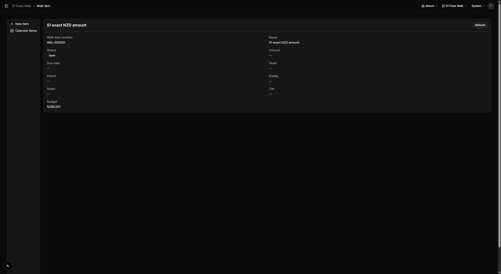
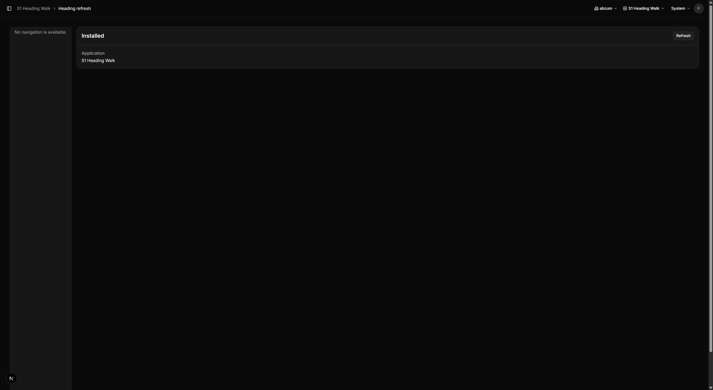
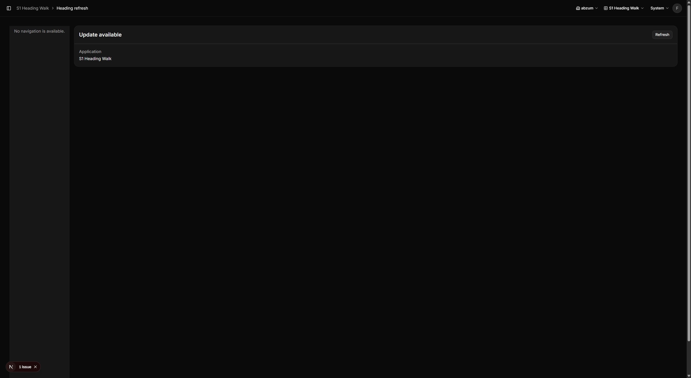
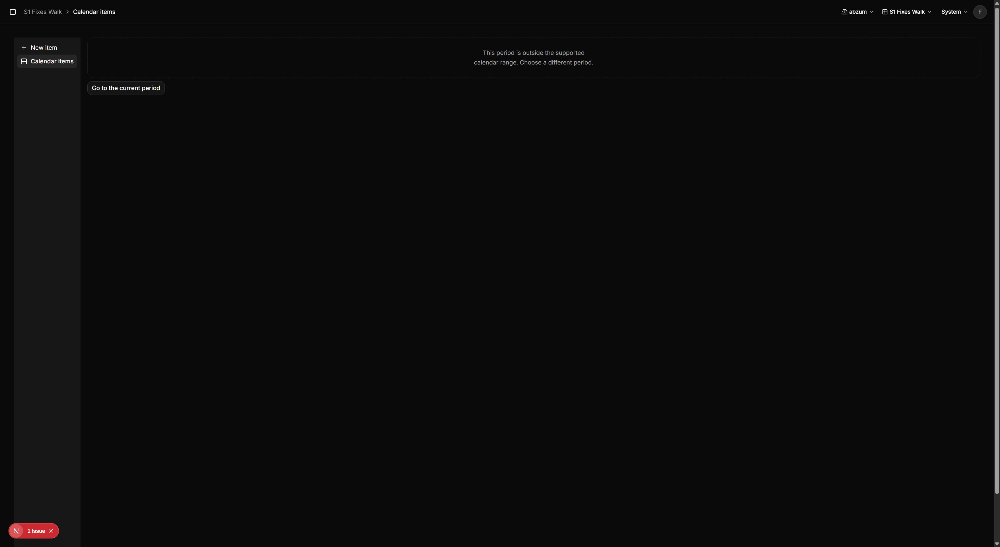
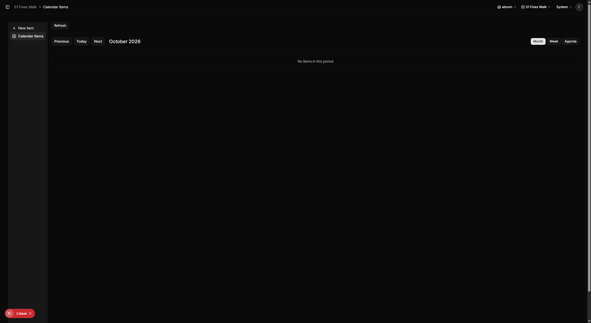
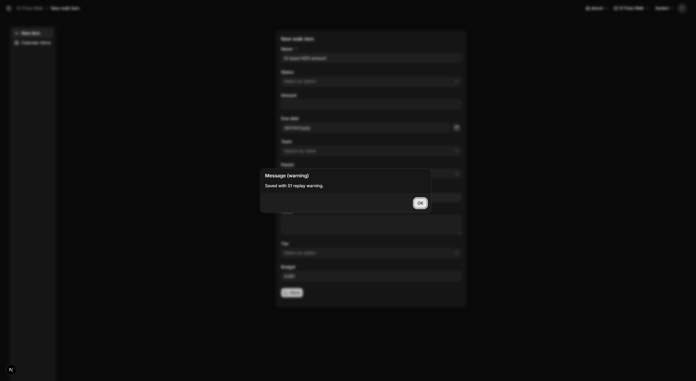

# S1 parked-fix walkthrough

Walked the behavior at `5abdb3d151e8a0c7b698163fb9c8d954788abf27` on db5 with the lane's provisioned owner, using `http://127.0.0.1:3581`.
No automated tests were written or run.

## Isolation and setup

- db5 was granted with RETAIN disposition. No reset or demo setup was run.
- The coordinator approved forward-applying only main migrations `20261025170000` and `20261025171000`, including their two history rows, because the CLI refused historical `20261025164000`, which is absent from main. That historical row remains. Before/after hashes were captured outside the repository.
- Retained R15 definitions were not changed. They are installed at application revision 149/module revision 26 and lack the current grid totals settings.
- Created, published and installed isolated fixtures through Studio's supported create, source review/save, publication and lifecycle review/install actions, under the signed-in lane owner. No direct definition or record writes were used.
- S1 Fixes Walk: `app.s1_fixes_walk`, root `3cbd9039-17f3-44d5-bb90-f092ff6b8bf5`, installed 1.0.0/revision 2; one new item. Its unpublished draft revision 3 changes a projection contract and was refused by version comparison; installed revision 2 is retained.
- S1 Heading Walk: `app.s1_heading_walk`, root `31aaffa4-46bf-43ec-9456-2ebe4ddddade`, installed 1.0.0/revision 1, published 1.0.1/revision 2 for the status transition. Both fixtures are CURRENT until this PR merges; disposition remains RETAIN.

## Per-issue observations

### #3542: exact stored money

Created item `e77e029e-16dc-4677-8607-dae95582fef1` through the form with Budget `0.001`.
A direct database read returned `{"amount":"0.001","currency":"NZD"}` at concurrency number 1.
Its detail displayed `NZ$0.001`.

### #3543 and #3544: heading-only polling and transient recovery

The heading fixture uses a read-only catalogue projection with `refresh_while.field = status`, `values = [installed]`, interval 2 seconds.
The detail heading is that status; its sole detail field is Application/name, so status is absent from the field list.
The visible heading initially showed Installed. One browser-injected 503 failed the next placement reread; subsequent real server rereads returned 200 at roughly 2.2-second intervals, and the heading recovered without a reload.

Then a description-only change was saved and published as 1.0.1 through the supported publication actions while leaving 1.0.0 installed.
The same mounted heading became Update available without navigation or reload. The poll count remained 20 on the later observation: the non-pending value stopped polling.
Refused, absent, awaiting and terminal-ready states clear pending tracking; error states retry only when an earlier ready payload was pending. Reads still require an on-screen placement in a visible document.

### #3545: excluded by the core ownership boundary

The parked Promise.race patch stops awaiting the iterator but explicitly leaves its in-flight database read running.
The real cancellation fix needs the caller in core-owned `packages/platform/src/pages/records-table-features/export.ts`, where the database request lifetime is not bound to the export signal.
No export code changes remain in this PR; #3545 remains open.

### #3546: leave a malformed calendar period

Opened calendar_items with `date.6735aa96-8002-3626-b910-cd3c5230d235=bad-date`.
The unsupported-period message and enabled Go to the current period button appeared.
Clicking it removed only that date parameter, returning to October 2026 with Previous, Today, Next and view controls.

### #3547: replay preserves the warning

The form's BeforeSave rule emits Saved with S1 replay warning.
The first save showed that warning in the app. Resent the exact captured `/api/flows/invoke` request, retaining its gesture ID; both responses returned run `492b137f-28bf-4154-8e10-f737df6075f4`, the same saved record and identical warning arrays.
The ledger held `{"record":"e77e029e-16dc-4677-8607-dae95582fef1","warnings":[{"code":"warn","message":"Saved with S1 replay warning."}]}`.
The saved record remained at revision 1 after replay.

## Static validation

- Changed-file Prettier check: exit 0, all five changed source files formatted.
- `pnpm lint`: exit 0.
- `pnpm typecheck`: exit 0, four packages successful.
- `pnpm build`: exit 0, production routes generated.
- `pnpm guard`: exit 0, zero blocking findings, 74 existing warnings.
- `pnpm verify`: exit 1 at format check, 179 files flagged, predominantly untouched on main. Ops Lead instructed changed-file checks and no unrelated reformatting.
