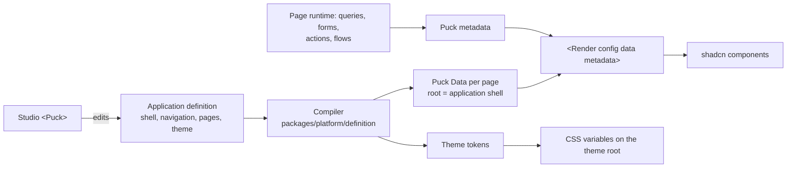

# Target architecture

**Status:** approved by the owner on 12 October 2026. It is authoritative for the reset epic [#2209](https://github.com/Abzum-NZ/Abzum-Vortex/issues/2209) and for all later work. Where an older document conflicts with this one, this one wins.

**Why this exists:** the 12 October audit found several problems:

- 270k lines of TypeScript spread across 23 packages.
- A contracts package that duplicates the runtime.
- About 146 V2/V3 copies and about 372 dead exports.
- 363 migrations containing more than 15 parallel record writers and 5 receipt tables.
- Errors swallowed into opaque codes.

Because of these, `main` could not run, even though dozens of "verified" merges had landed. This document defines the shape the code must converge to and the rules that keep it there. Every R2/R3 issue implements a section of it, and every review checks against it.

## 1. Product rules

1. **Everything renders from definitions.** This covers the application shell, navigation, pages, layouts, blocks, forms and theme. Engines are generic renderers and executors. Studio and App Builder edit the same definition data that the runtime renders.
2. **One renderer: Puck.**
   - A compiled page is Puck `Data`, rendered with `<Render config data metadata>`.
   - The one Puck `Config` (`createVortexPuckConfig`) maps every block to a shadcn/ui component.
   - Studio uses `<Puck>` with the same config.
   - No other code path draws a block.
3. **shadcn/ui is the only component library.**
   - Blocks and controls are composed from `packages/ui` shadcn components.
   - Theme tokens are CSS variables produced from the theme definition.
4. **Engines never name business applications.**
   - CRM, Service Desk, IAM, Landing Zone and similar names appear only in `packages/definitions` and in development setup.
   - Organisation configuration, such as the default application, carries the choice; code does not.
5. **No absent-setting behaviour.** A renderer never changes layout or behaviour because a setting is missing. Defaults are Puck `defaultProps` written into the definition.
6. **One current version of every contract.** There are no `V2`/`V3` siblings. A change to a contract updates the contract, its compiler and the shipped definitions together, because there is no released product to stay compatible with.
7. **Fail loudly on our own data.**
   - A parse failure of data the platform itself produced (request context, stored definitions, query rows) is a defect. Log it with its cause and surface it in development.
   - Never turn it into "unavailable" or `null`.
   - A refusal shown to a user is fine, but the server log must hold the real cause, such as the database error code and message.

   Two of the three blocking defects found on 12 October were hidden by this pattern.
8. **No process artefacts in product code.** Receipts, fingerprints, continuity evidence and proofs that exist only to satisfy a review process are not allowed. Idempotency, revisions and a release content hash are product features; keep each in exactly one place.

## 2. Repository layout

```
apps/web                 the only deployable: Next.js routes, server actions, thin glue
packages/platform        server library: every domain, schema and implementation together
  src/<domain>/          identity, access, definition, records, queries, pages, rules,
                         workflows, files, search, events, theme, catalogue
  src/db/                connection, transactions, request context
packages/ui              shadcn components, Puck config, blocks, controls, theme root, studio editor UI
packages/definitions     shipped application and module definitions plus their loader
supabase                 config, migrations, schemas/<schema>/<function>.sql, seed
tooling                  development scripts and the guardrail checks
docs                     specification and build plan
```

### Dependency direction

`apps/web` may use `platform`, `ui` and `definitions`. `ui` may use `platform/schema` only. `definitions` may use `platform/schema` only. Nothing imports `apps/web`, and `platform` imports neither `ui` nor `definitions`.

### Exports

`packages/platform` exposes two entry points:

- `@vortex/platform/schema`: isomorphic Zod schemas, types and pure helpers, safe for the browser.
- `@vortex/platform/server`: database-backed operations.

Server code must never reach the browser bundle.

### Domain module shape

- **One folder per domain.** Inside it, `schema.ts` holds the Zod schemas and inferred types, and the implementation files export plain functions that take a transaction and typed input.
- **No layers without a reason.**
  - Do not add a `-repository`, `-composition`, `-adapter`, `-port`, `-handoff`, `-coordinator` or `create…Service` factory unless there are genuinely two implementations.
  - Today's `x` / `x-repository` / `x-composition` / `x-catalogue` quadruples collapse into one module.
- **No file over 1,500 lines.** Split by concern, for example one file per definition node kind in the compiler and validator.
- **Routes in `apps/web` are thin.** Each parses the request, calls one platform operation and maps the result. Business logic does not live in `apps/web/app/_lib`.

## 3. Rendering pipeline



**Shell.** The application shell (sidebar, top bar, breadcrumbs, account menu) is the Puck root component, configured by the application definition.

**Theme.** One stylesheet plus per-application CSS variables, with fonts loaded through `next/font`. The seven pre-built style sheets and the font emit chain are removed (#2227).

**Runtime data.** Queries, form state, actions and flow continuations reach blocks through Puck `metadata`, never through module globals.

## 4. Database

### Schemas

| Schema | Holds |
|---|---|
| `identity` | tenants, organisations, accounts, invitations, identity projection, request context |
| `access` | permission catalogue, roles, role permissions, assignments, groups, access version |
| `definition` | roots, drafts, releases (with one `content_hash`), dependencies, installations |
| `record` | storage catalogue, field and relationship mappings, `record_data.*` tables, activity, change notices, idempotency |
| `platform` | files, search documents, connections, workflow runs, events, added only when their feature is built |

### Roles

- `vortex_owner` owns every object.
- `vortex_runtime` is the application login and may only execute the API functions.
- `vortex_record_adapter` is the role the record-data RLS policies are written for.

Per-schema owner roles are removed. The provisioning defect of 12 October came from grants missing across them.

### API surface

Tables are private. The application calls `security definer` functions with `set search_path = ''`. Tenant and organisation isolation comes from the validated request context inside every function, and RLS applies on `record_data.*`.

### Record writes

- **Every record write goes through `record.apply_record_changes`.** That covers create, update, relationships, named actions, lifecycle, restore, settings records and offboarding transfers.
- **Within that path, three steps each happen once:**
  - save rules run inside its transaction;
  - it appends activity through one `append_activity(kind, payload)`;
  - it publishes one change notice at its end.
- **Parallel writers are deleted,** and so are the `exact_*_notice` variants.

### Other database rules

- **Idempotency.** One table: `record.command_receipts(organization_id, command_id, kind, result, created_at)`. No other receipt tables.
- **Identifiers are data.**
  - The platform owner and the permission catalogue are rows, read by functions.
  - Functions contain no hard-coded UUIDs except the nil sentinel.
  - There are no versioned catalogue copies (`_v1_2_0`).
- **Migrations.** One baseline (#2236) followed by ordinary forward migrations. `supabase/schemas/<schema>/<function>.sql` remains the editable source of each function, and a migration that changes a function contains the identical full definition.
- **Deferred stacks.** A table or function stack with no shipped feature using it today is removed (#2240). Examples: capability metering, share consent, storage conversion, preview mirror, runtime bundles in the database, legal holds. The feature issue that needs it re-adds the simplest design that meets the specification, built to these rules.

## 5. Errors and logging

- **Platform result types.** Platform operations return either a typed result or a typed refusal. The refusal carries a stable code for the user and a `cause` for the log.
- **Shared mapping.** `apps/web` logs every refusal and unexpected error once, with route, operation, code and cause (never secrets or personal data). The database error-code mapping lives in one shared function, not per service.
- **Strict schemas stay strict, with no silent failure.**
  - When the database adds a field, update the schema in the same change.
  - Code must never handle a mismatch by quietly returning `null`.

## 6. Guardrails that keep it this way

Static checks run in CI on every pull request and locally with `pnpm guard`. They are lint-style rules, not tests. A check fails the build only on new violations: existing ones are listed in `tooling/guard/baseline.json`, which may only shrink.

| Check | Fails when |
|---|---|
| Business names | `packages/platform`, `packages/ui` or `apps/web` (outside development setup) contain a shipped application key or name |
| Versioned contracts | A new exported identifier ends in `V2`/`V3`/… or a file name ends in `-v2`/`-v3` |
| File size | A source file exceeds 1,500 lines |
| Unused code | knip reports an unused export, file or dependency |
| Layering | An import breaks the dependency direction in section 2 |
| Process artefacts | New identifiers or SQL objects named `*receipt*` (other than `command_receipts`), `*fingerprint*`, `*continuity*` or `*evidence*` |
| Migrations | A changed `supabase/schemas` function and the latest migration that defines it differ, or a function body hard-codes a non-nil UUID |
| Silent parse | `.safeParse(` whose failure branch returns `null`/`undefined`/`false` without logging, in `packages/platform` |

### Running app as the gate

Every pull request that changes behaviour states which pages were exercised on a freshly reset local database (sign-in, then the affected application pages). Reviewers re-run that walkthrough before merging, and a PR that changes what users see includes screenshots.

### Review checklist (pull request template)

- [ ] Matches this document. No new layer, version copy or process artefact.
- [ ] Root cause fixed, not a workaround at the symptom.
- [ ] No business names, no absent-setting behaviour, no hard-coded shell or theme.
- [ ] Errors keep their cause in the log.
- [ ] `pnpm guard`, `pnpm typecheck` and the local walkthrough pass.

## 7. Delivery order

1. Guardrails (#2209 child "Guardrail checks"), so new code is held to these rules from the first R2 PR.
2. U3 #2224: Puck Render cut-over, deleting the old renderers. Then U4 #2225: shell as definition.
3. R2.1 #2230, then R2.2 #2231, then R2.3 #2232, then R2.4 #2233, then R2.5 #2234, then R2.6 #2235: consolidation, done one PR at a time on a quiet `main`.
4. R3.1 #2236, then R3.2 #2237, then R3.3 #2238, R3.4 #2239, R3.5 #2240 and R3.6 #2241: database.
5. Feature phases resume on the simplified base.

The lead (Claude Opus 5.5) signs off every R2/R3 pull request against this document before merge.
