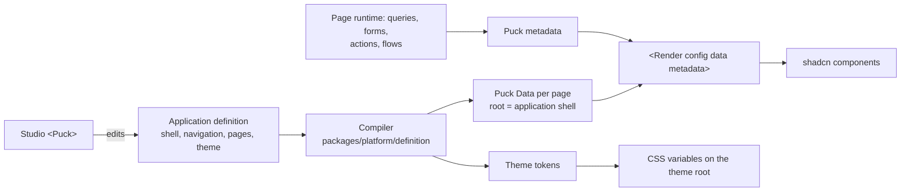

# Target architecture

**Status:** approved by the owner on 12 October 2026 and binding for all work. Where another document conflicts with this one, this one wins.

This document defines the shape the code keeps and the rules that keep it there. Every review checks against it.

## 1. Product rules

1. **Everything renders from definitions.** This covers the application shell, navigation, pages, layouts, blocks, forms and theme. Engines are generic renderers and executors. Studio and App Builder edit the same definition data that the runtime renders.
2. **One renderer: Puck.**
   - A compiled page is Puck `Data`, rendered with `<Render config data metadata>`.
   - The one Puck `Config` (`createVortexPuckConfig`) maps every block to a shadcn/ui component.
   - Studio uses `<Puck>` with the same config.
   - No other code path draws a block.
3. **shadcn/ui is the only component library.**
   - Blocks and controls are composed from `packages/ui` shadcn components.
   - Theme tokens are CSS variables produced from the theme definition.
4. **Engines never name business applications.**
   - IAM, Landing Zone and similar application names appear only in `packages/definitions` and in development setup.
   - Organisation configuration, such as the default application, carries the choice; code does not.
5. **No absent-setting behaviour.** A renderer never changes layout or behaviour because a setting is missing. Defaults are Puck `defaultProps` written into the definition.
6. **One current version of every contract.** There are no `V2`/`V3` siblings. A change to a contract updates the contract, its compiler and the shipped definitions together, because there is no released product to stay compatible with.
7. **Fail loudly on our own data.**
   - A parse failure of data the platform itself produced (request context, stored definitions, query rows) is a defect. Log it with its cause and surface it in development.
   - Never turn it into "unavailable" or `null`.
   - A refusal shown to a user is fine, but the server log must hold the real cause, such as the database error code and message.
8. **No process artefacts in product code.** Receipts, fingerprints, continuity evidence and proofs that exist only to satisfy a review process are not allowed. Idempotency, revisions and a release content hash are product features; keep each in exactly one place.

## 2. Repository layout

```
apps/web                 the only deployable: Next.js routes, server actions, thin glue
packages/platform        server library: every domain, schema and implementation together
  src/<domain>/          identity, access, definition, records, queries, pages, rules,
                         workflows, files, search, events, theme, catalogue
  src/db/                connection, transactions, request context
packages/ui              shadcn components, Puck config, blocks, controls, theme root, studio editor UI
packages/definitions     shipped application and module definitions plus their loader
supabase                 config, migrations, schemas/<schema>/<function>.sql, seed
tooling                  development scripts and the guardrail checks
docs                     specification and build plan
```

### Dependency direction

`apps/web` may use `platform`, `ui` and `definitions`. `ui` may use `platform/schema` only. `definitions` may use `platform/schema` only. Nothing imports `apps/web`, and `platform` imports neither `ui` nor `definitions`.

### Exports

`packages/platform` exposes two entry points:

- `@vortex/platform/schema`: isomorphic Zod schemas, types and pure helpers, safe for the browser.
- `@vortex/platform/server`: database-backed operations.

Server code must never reach the browser bundle.

### Domain module shape

- **One folder per domain.** Inside it, `schema.ts` holds the Zod schemas and inferred types, and the implementation files export plain functions that take a transaction and typed input.
- **No layers without a reason.**
  - Do not add a `-repository`, `-composition`, `-adapter`, `-port`, `-handoff`, `-coordinator` or `create…Service` factory unless there are genuinely two implementations.
  - Today's `x` / `x-repository` / `x-composition` / `x-catalogue` quadruples collapse into one module.
- **No file over 1,500 lines.** Split by concern, for example one file per definition node kind in the compiler and validator.
- **Routes in `apps/web` are thin.** Each parses the request, calls one platform operation and maps the result. Business logic does not live in `apps/web/app/_lib`.

## 3. Rendering pipeline



**Shell.** The application shell (sidebar, top bar, breadcrumbs, account menu) is the Puck root component, configured by the application definition.

**Theme.** One stylesheet plus per-application CSS variables, with fonts loaded through `next/font`.

**Runtime data.** Queries, form state, actions and flow continuations reach blocks through Puck `metadata`, never through module globals.

## 4. Database

### Schemas

| Schema | Holds |
|---|---|
| `identity` | tenants, organisations, accounts, invitations, identity projection, request context |
| `access` | permission catalogue, roles, role permissions, assignments, groups, access version |
| `definition` | roots, drafts, releases (with one `content_hash`), dependencies, installations |
| `record` | storage catalogue, field and relationship mappings, `record_data.*` tables, activity, change notices, idempotency |
| `platform` | files, search documents, connections, workflow runs, events, added only when their feature is built |

### Roles

- `vortex_owner` owns the tables, sequences, types and functions in the five `vortex_*` schemas, except the record objects deliberately owned by `vortex_record_adapter` or `vortex_record_inventory` and four integration functions. `vortex_identity.complete_identity_disablement` deletes GoTrue-managed `auth.sessions` rows; `vortex_platform.may_receive_topic` calls `auth.uid()`; `vortex_platform.request_event_dispatch_wakeup` calls `net.http_post`; `vortex_platform.publish_change_notice` calls `realtime.send`, which inserts into the `supabase_realtime_admin`-owned `realtime.messages` that `postgres` may use but cannot grant onward. These retain `postgres` ownership so the integration privileges stay within their existing boundaries. Where `postgres` can grant the integration privilege, the function moves to `vortex_owner` with only that privilege: the Event append holds just the PGmq schema and its one occurrence queue.
- `vortex_owner` is NOLOGIN and has `BYPASSRLS`. Security-definer functions owned by it retain the access that their former `postgres` ownership provided on FORCE RLS tables. The restricted record roles do not have `BYPASSRLS`; their organisation-scoped policies continue to apply.
- `vortex_runtime` is the application login and may only execute the API functions.
- `vortex_request` is the role every request transaction runs as; the API functions, record writes included, are granted to it, never the owner-only `*_internal` helpers. Request code never switches back to `vortex_runtime`, with one explicit exception: tenant governance runs its one identity operation under `vortex_runtime` inside a savepoint that admits exactly one call and restores `vortex_request` before it settles (`identity/tenant-governance-request-bound.ts`).
- `vortex_record_adapter` is the role the record-data RLS policies are written for.
- `vortex_record_inventory` is the second restricted role: the account-deletion inventory reads record data through organisation-scoped policies.

The local signup privacy integration uses `vortex_identity.before_user_created`, owned by
`vortex_owner` and executable only by `supabase_auth_admin`. It validates the acknowledgement and
refuses public self-registration without it. GoTrue v2.196.0 refuses to call the hook inside a
transaction, so the hook cannot write evidence that commits or rolls back with the account.
`vortex_identity.append_signup_privacy_acknowledgment`, also owned by `vortex_owner`, therefore
writes the evidence (identity, notice version, time, server-derived channel and a correlation
ID; no IP or user agent) from an `auth.users` AFTER INSERT trigger for every account that claims
an acknowledgement.
Admin API provisioning does not pass through the hook, claims none and records none. Both use
one private validator and a fixed empty search path. The trigger does not alter Auth rows.
Hosted activation requires separate rollout approval.

Rollback, in one transaction as `postgres` and keeping the version and evidence tables: disable
the hook configuration, then `drop trigger if exists vortex_signup_privacy_acknowledgment on
auth.users`; as `vortex_owner` (the grantor), `drop function if exists
vortex_identity.append_signup_privacy_acknowledgment()`, `revoke execute on function
vortex_identity.before_user_created(jsonb) from supabase_auth_admin` and `drop function if exists
vortex_identity.before_user_created(jsonb)`; then, as `postgres` (the schema owner), `revoke usage
on schema vortex_identity from supabase_auth_admin`. The statements are listed in migration
`20261025184000_signup_privacy_notice.sql`.

The operational `postgres` role retains explicit privileges on the transferred objects for the local seed and controlled migrations; ownership remains with `vortex_owner`. The restricted record roles and their organisation-scoped grants and policies remain separate.


### API surface

Tables are private. The application calls `security definer` functions with `set search_path = ''`. Tenant and organisation isolation comes from the validated request context inside every function, and RLS applies on `record_data.*`.

### Record writes

- **Every record write goes through `record.apply_record_changes`.** That covers create, update, relationships, named actions, lifecycle, restore, settings records and offboarding transfers.
- **Within that path, three steps each happen once:**
  - save rules run inside its transaction;
  - it appends activity through one composer, `append_record_activity_internal`, over the one
    insert `append_organization_activity_entry`;
  - it publishes one change notice at its end.
- **There are no parallel writers.** Account offboarding transfers, including those of a retained
  row or a detached installation's record, are `apply_record_changes` operations.
- **One maintenance write.** `apply_derived_field_backfill` stores the totals and stored
  calculations the platform works out for existing records when a definition adds a derived
  field. It is not a change anyone made: it writes only those derived columns under the record's
  revision check, moves the revision so an open form refreshes, and records no Activity or Event.

### Other database rules

- **Idempotency.** One table: `vortex_record.command_receipts(command_id, organization_id, tenant_id, actor_id, command_kind, result, created_at)`: the command id is the key, and a replay returns the stored result only when the organisation, tenant, actor and kind match. Record, identity and access commands each use their own `command_kind`. No other receipt tables.
- **Identifiers are data.**
  - The platform owner and the permission catalogue are rows, read by functions.
  - Functions contain no hard-coded UUIDs except the nil sentinel.
  - There are no versioned catalogue copies (`_v1_2_0`).
- **Migrations.** One baseline followed by ordinary forward migrations. `supabase/schemas/<schema>/<function>.sql` remains the editable source of each function, and a migration that changes a function contains the identical full definition.
- **No deferred stacks.** A table or function stack exists only while a shipped feature uses it; the feature that needs one adds the simplest design that meets the specification, built to these rules. Installation runtime bundles (the compiled sections an active installation serves) and the preview copy of live records (Studio preview with real data) are such features.

## 5. Errors and logging

- **Platform result types.** Platform operations return either a typed result or a typed refusal. The refusal carries a stable code for the user and a `cause` for the log.
- **Shared mapping.** `apps/web` logs every refusal and unexpected error once, with route, operation, code and cause (never secrets or personal data). The database error-code mapping lives in one shared function, not per service.
- **Strict schemas stay strict, with no silent failure.**
  - When the database adds a field, update the schema in the same change.
  - Code must never handle a mismatch by quietly returning `null`.

## 6. Guardrails that keep it this way

Static checks run in CI on every pull request and locally with `pnpm guard`. They are lint-style rules, not tests. Any blocking finding fails the build; an intentional exception carries a reviewed `guard-allow` comment. `tooling/guard/config.ts` is the list of rules and their tiers; AGENTS.md summarises them.

### Running app as the gate

Every pull request that changes behaviour states which pages were exercised on a local database lane (sign-in, then the affected application pages). Reviewers re-run that walkthrough before merging, and a pull request that changes what users see includes screenshots.

### Review checklist (pull request template)

- [ ] Matches this document. No new layer, version copy or process artefact.
- [ ] Root cause fixed, not a workaround at the symptom.
- [ ] No business names, no absent-setting behaviour, no hard-coded shell or theme.
- [ ] Errors keep their cause in the log.
- [ ] `pnpm guard`, `pnpm typecheck` and the local walkthrough pass.
