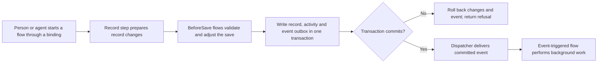
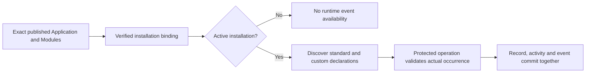
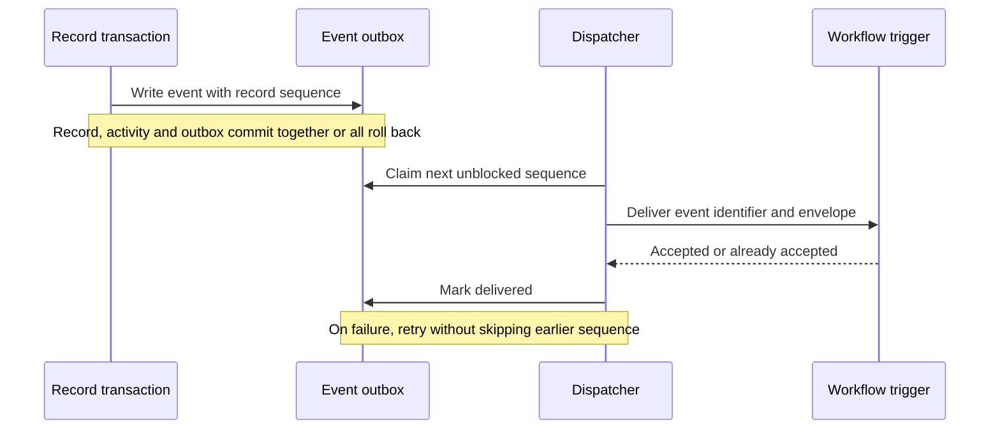

# 8. Forms, actions, rules and events

[Previous: Applications, navigation, pages and themes](07-applications-pages-and-themes.md) · [Specification index](README.md) · Next: [Workflows and process pipelines](09-workflows-and-pipelines.md)

## Behaviour levels

The platform separates work that must finish during a [record save](06-records-and-lifecycle.md) from work that can continue afterward.

Every behaviour is a **flow** in the one [flow language](appendices/frontend-rule-designer.md#one-flow-language). An **action** is a flow a person or agent starts through a binding; a **named action** is a declaration plus exactly one `transaction` flow of its Module (or one protected operation), whose record changes compile into one protected apply-record-changes call. A **rule** is a flow with a `BeforeSave` trigger that runs inside the save. An **event** is a committed statement that something happened. Work after a change is a flow with an `Event` trigger (an after-save subscriber), and work that runs apart from the request runs through a [back-end adapter](09-workflows-and-pipelines.md). The [Frontend Rule Designer](appendices/frontend-rule-designer.md) is the one authoring surface for all of them, reusing the Conditions Designer and Page Designer forms.

A user-facing action always enters a flow through its binding: the exact flow id plus a typed input map. A popup-only or navigation-only flow finishes without a business submission. The default Save of a form is a generated one-task flow, `record.save`. The [flow-first binding rules](appendices/frontend-rule-designer.md#pages-compose-flows-define-actions) separate page composition from behaviour without replacing the owning services.

An interactive flow may collect forms, query data and execute several changing tasks in its configured order. Publication and the runtime compile each flow once per release into a plan of page segments and server segments ([Amendment A](../build-plan/architecture-decisions.md)). In the page and in WebMCP, page steps run in the browser and each server segment is one request and one transaction; an external API or MCP client is driven by the server, which returns page steps as intents with a continuation. Today the server drives every channel; the page driver arrives with the page runner. Each server segment commits independently; cancellation or later failure does not undo earlier commits. The collect-first pattern remains available: collect all required answers before one record task when no business changes should occur until every form passes. Each protected task revalidates its required path, inputs, current authority and revisions. No database transaction spans human or network waits. See [execution and custom forms](appendices/frontend-rule-designer.md#custom-forms-and-all-or-nothing-submission).

## Actions

A **named action** is a declaration: `id`, `key`, `label`, `record_type`, `permission`, `shareable`, `inputs`, `precondition`, and exactly one `flow` of its Module or one `protected_operation`. It is not a task list: the flow owns the steps. It belongs to a module when it expresses reusable business meaning, or to an application when it exists only for that application. It runs as the flow's `runAs` (the initiating person, or the saver for a transaction flow), and its invocation permission is checked before it starts.

Its inputs use names, labels, types, required flags, and validation valid for that type from the one value-type catalogue. Plain text accepts length and pattern constraints; formatted text accepts a closed block allowlist and maximum length; numbers accept numeric bounds; dates and date-times accept their own bounds; a record reference names one or more allowed record types; an organisation-account reference selects an account in the current organisation; a Boolean accepts none of those unrelated settings. A named action also records a precondition and the events it may announce.

The flow's record steps compile into **one** apply-record-changes call, so they succeed or fail together. Apply record changes enforces, for every call, the access decision for each touched record, field permissions, pipeline transitions and gates, action-only fields, revision checks, `BeforeSave` flows and computed values. A pipeline stage field changes only through its named transition action. Every field, record type, relationship, input and event named by a step must resolve during publication. A relationship step never means "all relationships"; the authored step lists the relationship keys and publication resolves them to permanent relationship identifiers.

A named action cannot wait, call an external system, send email, send notifications, invoke a model, run unbounded reads or start background work; follow-up work is a flow with an `Event` trigger, and work that runs after the request commits starts on the back end.

## Rules

A **rule** is a flow with a `BeforeSave` trigger and the `transaction` execution kind. It declares the same fields as every [flow](appendices/frontend-rule-designer.md#flow-shape). Examples: a required value, an allowed status change, "a resolved case needs a resolution time". Its trigger names the record operations it covers: `create`, `update`, `delete` and `restore`. Rules on the same record type run in the order of the record type's ordered rule list, shown in Studio as that list; there is no hidden priority number. Every applicable rule runs; any refusal stops the save, and warnings are collected and shown together. A rule covering `delete` or `restore` reads the record's stored values as both `{{ trigger.record.* }}` and `{{ trigger.previous.* }}` and may only branch, stop, warn or refuse; the one record writer applies rules to deletes and restores. A rule belongs to the module that owns its record type. In Studio it is added on the record type in the Data tab (Rules before saving), which lists each rule with when it runs and what it refuses, warns or requires, and it is edited on the Flows tab with the same step editors as every flow. Rules run inside every save of the record through the one record write path, whichever way it is saved: a form, a board move, a named action or a Save record step. A pipeline's allowed moves are enforced at the same single point.

A rule's ordered steps may contain only transaction-safe steps:

- If, Switch, Set variables and Calculate.
- Set field on the record being saved.
- A requirement.
- Warn without refusing.
- Refuse with a field-level message, or Stop.
- Query records under the saver's authority.

The server runs every applicable rule inside apply record changes for every writer: web, agent, interface, import and the back end. Its refusals, requirements and warnings are authoritative, and no binding, button or raw call can evade it. A rule cannot show or hide fields, wait for a person, switch identity, start background work or commit independently. Presentation belongs to the interactive flow bound to the form, and work after the change belongs to a flow with an `Event` trigger.

The page runner runs page rule steps while a person edits, to show predicted requirements, warnings and refusals at once. Page rule steps are feedback only: they never write a record, event or external effect, their results are never trusted, and the server re-evaluates every rule against current data before saving.

Flows must declare their read fields and write fields. Publication refuses cycles, conflicting writes without a declared order, a task placed outside its declared run locations, and a flow that reads information unavailable to its execution kind.

## Conditions

Conditions use a closed, typed vocabulary such as equals, not equals, comparison, between, empty, not empty, contains, changed, and is one of. Operators are allowed only for compatible field types.

Conditions may refer to:

- A field on the subject record.
- Its previous value during a change.
- A declared action input.
- A value carried by an event.
- A setting on the same page block when controlling builder presentation.

Relationship traversal is limited and validated. Conditions cannot execute code or network calls.

The early [record-visibility foundation #36](https://github.com/Abzum-NZ/Abzum-Vortex/issues/36) supplies the shared typed Boolean evaluator using the existing condition contract. It validates the complete tree and declared inputs before evaluating truth: invalid or missing input cannot become an allowance through negation or a short-circuited branch. Values are compared without implicit type conversion, and pure evaluation and PostgreSQL restrictions use the same tested meaning. The [condition builder #57](https://github.com/Abzum-NZ/Abzum-Vortex/issues/57) later adds authoring and general-rule extensions to that same implementation; the operators listed conceptually above are not a claim that all extensions already ship.

The current Module contract supplies the [exact-value Rule semantics](https://github.com/Abzum-NZ/Abzum-Vortex/issues/44)
needed by its field definitions. Select them from the trusted owning Module
contract, not from how an incoming value looks or the containing Application's
version. Keep the same condition tree and error meanings. Decimal and money
parameters are explicit exact-value types; an explicitly declared `number`
parameter uses its finite-double meaning. Runtime, publication validation and
database-backed predicates apply the same declared operand semantics. No obsolete
evaluator or representation conversion is retained, and the visual Conditions
Designer is not required to execute these semantics.

Application-owned rules, actions, queries, pipeline gates and record-bound
workflow conditions use the value format of the exact Module owning the fields
they consume. Literal assignments use the target field's format; field-to-field
and input mappings must have compatible declared formats. A containing
Application's format version cannot turn an exact decimal into a floating-point
number, reinterpret money currency, or turn ordinary text into a number. Compile
and validate these consumers with the same owning helpers described in the
[field-value plan](https://github.com/Abzum-NZ/Abzum-Vortex/issues/44).

A workflow input bound to a record field retains its declared allowed record
types. The field's possible targets must fit within that declaration; downstream
tasks use the declaration when checking their own accepted targets. Historical
canonical inputs that omitted this metadata use the owning field's targets.
These type declarations never grant access to the referenced records.

The [rules domain](../../packages/platform/src/rules) is shared by Definition and Access in the platform package. Both reuse its pure evaluator; the existing Definition entry delegates to it. This does not introduce another service, expression language, database connection or browser-side authority. Record visibility still requires the same semantics in publication, protected reads and database enforcement.

## Events

Every record type provides seven standard events:

- Created.
- Changed, with changed field names.
- Deleted, with record identifier and record type.
- Linked.
- Unlinked.
- Reassigned.
- State changed, with field and previous/new values.

A module may declare additional business events. An event carries identifiers and the minimum non-personal values required to choose later work. It never carries a complete record or a field classified as personal or sensitive. A workflow re-reads permitted current data when needed.

The same rule applies to standard events: a state-change fact can identify the
record and changed field, but its previous/new values are omitted when classified
as personal or sensitive. This does not prevent the record change or suppress
the safe lifecycle fact. Application-owned custom events use the same declaration
and carried-value rules as Module-owned events.

### Installed event availability

An event declaration describes what may happen; an event occurrence records that
it happened. Publication creates only the declaration. Installing and activating
an exact Application release makes its standard and custom events, and those of
its exact bound Module releases, available in that installation. Detachment stops
new use there without deleting definitions needed by other installations or
historical occurrences.

The immutable published definitions and actual installation bindings are the
authority for discovery and declaration validation. Registration is not a second
editable copy of those definitions or an `eventsRegistered` success flag. A retry
reuses the same scoped declaration identities; an explicit installation upgrade
changes the exact release it resolves, not the meaning of an older installation's
events. No event is queued merely by publication, registration or discovery.

## Event envelope

Every event envelope includes:

- Unique event identifier.
- Organisation, application, module, record type, and record identifiers where applicable.
- Event name and published definition versions.
- Occurrence time, initiating person, correlation identifier, and causation identifier.
- Per-record sequence number.
- Declared carried values.

The unique occurrence identifier is separate from the reusable custom event
declaration identifier. Resolve a custom event by its exact owning Application
or Module release and permanent declaration reference, retaining its published
namespaced key. Resolve a standard event by its fixed kind and owning record
type/release. Never infer either identity from a display label. Introduce the
explicit versioned runtime envelope before delivery; preserve historical envelope
contracts rather than silently changing their meaning.

Event keys are resolved within their owning Application or Module; an identical
key in another owner is not the same declaration. Validate carried values with
the same field meanings used by Record, not a separate event-specific validator.
A state change can set a previously absent value or clear a present one. Its
before/after representation must preserve that absence distinction; classified
values remain omitted while the safe record and field identifiers are retained.

## Starting back-end work

Every user-facing action starts a frontend flow through its binding. A frontend flow runs work apart from the request only through a **Run on back end** (`backend.run`) step with declared typed inputs, in mode `await` (the step returns the child's outputs) or `start` (the step returns a run reference and the child runs after the reply). A committed record change reaches later work only through an `Event`-triggered after-save subscriber. Neither holds a record transaction open while the back end runs.

The back end is an adapter. The `simulated` adapter is the only one: it runs the child flow's plan with the same interpreter on the server, as the initiator, in its own transaction after the calling segment commits. `backend.run` ends a server segment. After-save subscribers run once each after the commit; one failing does not undo or block another, and a subscriber may declare "run after" another (Studio refuses cycles). A refused or rolled-back save starts nothing.

## Delivery guarantees

The private immutable outbox is the one delivery path. The fixed append helper is available only to the non-login role owning protected Record adapters, never directly to runtime or browser callers. Current verified context supplies actor and correlation; the database supplies occurrence time. Previous record-editor metadata must not be mistaken for the actor of a new event. An occurrence carries its unique identifier, not record contents or a reusable event-declaration identifier.

The helper coordinates with the existing Module lifecycle lock before it rereads
the exact active installation, binding and release. Activation, detach or
replacement therefore cannot leave a waiting append using stale installation
evidence. That lifecycle lock is shared by appends; the actual generated Record
row remains the ordering lock, so different records in the same Application and
Module can proceed independently. A missing row or a row contained by another
Application is refused without an outbox row or partial batch.

Sequence follows actual record identity. An organisation-shared record has one
sequence across consuming Applications; application-contained records retain
their Application scope. The locked row and indexed outbox maximum provide the
sequence, without a second counter or timestamp ordering mechanism. The private
append prerequisite alone is not the complete protected save or dispatcher.
Ordered delivery, claiming, retries, consumer receipts and recovery are the event dispatcher's.

- The record change, activity and event outbox row are written in the same database transaction. Dispatch starts only after commit; it is not responsible for filling a gap between a committed record and its event.
- Event preparation and event persistence are distinct. The required Event participant prepares exact occurrence facts; the protected Record database save invokes the private Event append helper unconditionally. Request/runtime roles cannot call that helper directly or fabricate a save-success claim. See the [reviewed save/event boundary](../build-plan/module-record-provisioning.md#event-ownership).
- Reuse BeforeSave flows and the one record writer for business evaluation; do not introduce a second PostgreSQL rules or calculation engine for this handoff. Database-authoritative access, scope, revision, constraints and atomic persistence remain enforced by the owning protected writer.
- Delivery is at least once; each consumer scopes duplicate protection to its own identity and the event identifier. Flow acceptance additionally includes the exact installation revision, flow and trigger, so one event can start different flows without suppressing either one.
- Events for the same record are handed to consumers in sequence order.
- A later event cannot cause an earlier undelivered event to be discarded. The dispatcher waits, retries, or moves the blocked sequence to an operator-visible failure state.
- A permanently failed event remains available for authorised retry and investigation.
- The transaction writes only the event outbox; `event_outbox` is the one delivery path. After each committed request the server schedules the platform dispatcher in process for normal low-latency delivery, and a scheduled recovery wake-up calls the protected dispatcher endpoint to reclaim missed or stalled work. Delivered outbox rows older than 30 days are deleted in bounded batches by the dispatcher wake-up.

## Acceptance examples

- A refused save does not emit an event or start back-end work.
- Page steps produce no side effect; every server segment rechecks current permission, installation, definition, subject, path guard and typed inputs.
- Re-delivering an event does not run an after-save subscriber twice.
- A later change cannot overtake an earlier failed event for the same record.
- A rule that drops an unsafe condition cannot publish; it must express a safe condition or refuse the operation.
- Actions called from pages and agents all start a flow through a binding and follow the same validation and permission path. No form, interface or tool binds a lower-level operation directly, and the page model does not provide a second action executor.

## Page binding boundary

[Typed page, form and flow bindings](appendices/page-builder-contracts.md#forms-actions-and-semantic-controls) map each surfaced action to a flow binding: the exact flow id plus a typed input map. A record, Run flow or protected-operation task inside that flow invokes apply record changes, a named action, or a closed protected platform operation for an authorised administration form. A form, interface operation or agent tool binds the flow entry point (a one-task flow by default) and never the operation directly. No component silently saves, and no frontend binding permits arbitrary RPC or bypasses current access, validation, revisions or duplicate protection. Mandatory business rules must also hold for every permitted direct service/interface invocation; hiding or replacing a button never changes them.

## Configured effects and execution identity

Component load, refresh and other declared events can invoke read/write task sequences. Page steps have no effects; server segments invoke protected services for effectful steps. Each protected step runs as the flow's `runAs`: the initiating person (an agent acts as its person) or the saver for a transaction flow. Access is rechecked before every protected step. Operation atomicity and outbox guarantees apply per committed server segment, not to all previously completed segments in the flow. A started back-end run is not undone because a later form is cancelled.

## Component events and bindings

A component placement binds each semantic event it raises to exactly one flow. Every existing event name stays (`action`, `form_submit`, `row_action`, `row_clicked`, `field_changed` and the rest); contract 4 adds `field_focus_lost`, `options_requested` (the one options event), `form_cancel`, `record_loaded` and `batch_edit` (paste, fill and undo). Studio shows friendly labels.

A binding carries the flow id, a typed input map and these settings, each written into the definition with its default: a `condition`, `debounceMs` (0 to 250), `concurrency` (`ignore_while_running`, `latest_wins` or `queue`), `exclusive` (`none`, `form` or `page`) and `timeoutMs`. Publication refuses `latest_wins` on a binding whose flow changes data, and an exclusive binding without a timeout. A start arrives through a channel: `web` (the page), `webmcp` (an agent in the person's page), `programmatic_interface`, `connection`, `federation` or `system`. The idempotency key is the gesture or form-instance id, the segment id and the iteration path, shared by people and agents.

A choice or link field declares one options source (a fixed list, a query binding with declared inputs, or an options flow returning value, label and description). Options run under the person's permissions, load on demand, are cached per input values, and the save re-checks the chosen value inside its transaction. An options flow holds only pure and read steps.
