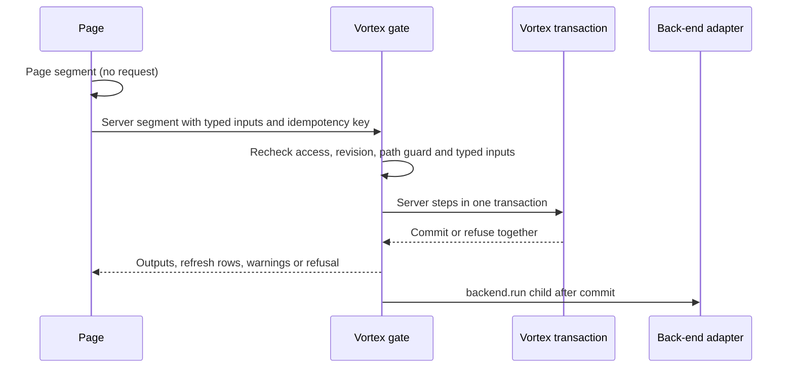
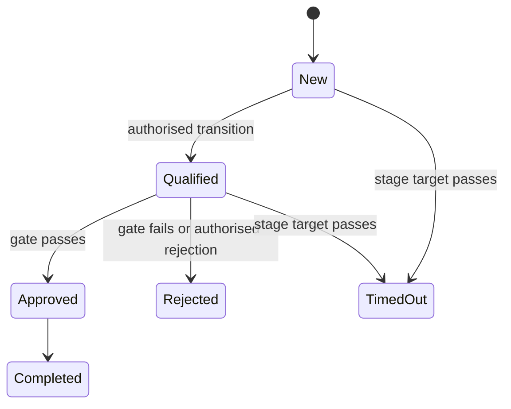

# 9. Workflows and process pipelines

This chapter specifies the product's workflow engine and process pipelines.

[Previous: Forms, actions, rules and events](08-forms-actions-rules-and-events.md) · [Specification index](README.md) · Next: [Queries, reports, search and live updates](10-queries-reports-search.md)

## Purpose and authority

A **back-end flow** is a flow that runs apart from the request that started it: a child started by a **Run on back end** (`backend.run`) step, or an after-save subscriber started by a committed record `Event` ([Amendment A](../build-plan/architecture-decisions.md)). There is no separate workflow language, engine or catalogue: every flow uses the one [flow language](appendices/frontend-rule-designer.md#one-flow-language), the one task registry, the one compiler and the one validator. A **process pipeline** describes the business stages through which a record moves; its transitions and entry and exit effects are tasks inside flows.

A back-end flow runs through a **back-end adapter**. One adapter exists, `simulated`: it runs the flow's compiled plan with the same interpreter on the Vortex server, as the initiator, in its own transaction after the calling segment commits. `await` mode returns the child's outputs to the caller; `start` mode returns a run reference and runs after the reply.

Vortex remains authoritative for identities, tenant and organisation context, permissions, definitions, records, files, connections, and every application side effect. A back-end adapter receives no organisation database credential and cannot grant access or write organisation tables directly.

## Triggers

A flow's `triggers[]` holds only its automatic starts. The contract has exactly two:

| Trigger | Starts | Execution kind |
| --- | --- | --- |
| `BeforeSave` | Inside the save transaction of a named record type, before commit, for every writer, in the order of the record type's ordered rule list | `transaction` |
| `Event` | After a committed record change: one of the eight standard [events](08-forms-actions-rules-and-events.md#events) or a declared business event. An after-save subscriber runs once on the back-end adapter and may declare "run after" another subscriber | `background` |

Every other start is a **binding**, not a trigger: a component placement, navigation item, form commit, interface operation, page-model tool or parent flow holds the exact flow id plus a typed input map. Pages never hold flow logic of their own.

### The record a flow runs for

A flow reads the record it runs for in one way: `{{ trigger.record.<field> }}`. A `BeforeSave` flow's record is the record being saved (with `{{ trigger.previous.<field> }}` for its values before the change), an `Event` flow's is the record the event is about, and a named action's is its subject. An `interactive` flow bound to a record (a button on a record page, a board's card move) names the input that carries that record in its `recordInput`: a required `record_reference` input of exactly one record type. When the flow starts, and again for each server segment that reads it, the platform reads that record afresh under the initiator's current access, with field-level read policy applied: a field the initiator may not read reads as empty, and a record the initiator may not read refuses the start. The values are typed by their fields. Only the started flow reads its record; a flow it runs through Run flow reads none. There is no separate step that loads the current record. Studio's condition and value controls offer the record's fields with their types and, for a choice, its options.

A **frontend flow** is a flow a person or agent starts through a binding (`interactive`, or `transaction` for a named action); a **back-end flow** runs through the back-end adapter (`background`). There is one start path ([#979](https://github.com/Abzum-NZ/Abzum-Vortex/issues/979)):

1. Every button, menu command, record gesture, page-model tool call and interface operation starts a frontend flow through its binding. A form, interface operation or agent tool binds a flow entry point — a generated one-task flow by default — and never binds a lower-level operation directly. An interface read operation or a query tool names a declared query, which the Query engine runs directly under the caller's access; a data flow is used only when a builder adds transform or write steps.
2. A frontend flow starts a back-end flow only through a **Run on back end** (`backend.run`) step with declared typed inputs. The step ends a server segment; the child runs after that segment commits. A `transaction` flow runs inside a record save and cannot contain `backend.run`, and the target flow holds no page steps.
3. Back-end flows are otherwise started only by a committed record `Event`, and may call one another only with typed inputs and outputs through a **Run flow** or **Run on back end** step.

A flow a person or agent starts is an **action**; a lower-level protected change such as apply record changes is an **operation**, not an action.

Each trigger declares its typed inputs, a nullable entry condition and its duplicate-protection rule. Publication matches every declared input to its exact owning contract and refuses missing, extra or invented inputs. An `Event` trigger names both the event and its record type; publication proves that the event exists, belongs to that record type, and carries every declared record-field input the flow reads. A condition may reference only fields on the actual event or binding subject record.

The [Frontend Rule Designer](appendices/frontend-rule-designer.md) authors triggers, bindings and tasks in the same designer for every execution kind. A Show form step may collect private draft answers between server segments; the draft is private to the person, form, subject, application and organisation. No database transaction stays open while awaiting a person. Each server segment of an interactive flow is one request and one transaction, so earlier committed segments remain committed when a later one fails.

Flow inputs map explicitly to declared trigger inputs through the versioned binding extension. This is a validated snapshot, never a shared mutable environment or a wholesale browser-variable payload. No unrelated interface or child-flow payload is silently widened.

### Interactive and save hand-off

Publication and the runtime compile each flow once per release into a plan of page segments, server segments and back-end steps; the plan is cached with the installation's runtime bundle and never stored. In the page and in WebMCP, page steps run in the browser and each server segment is one gated request: Vortex reloads the current active installation and the exact published binding, checks the caller's current permission, subject revision and the segment's path guard, validates only the declared typed inputs, and runs the segment's server steps in one transaction. Values a segment returns and the page sends to a later segment are caller inputs, re-validated by type and access. The browser plan holds only page steps and segment stubs (id, input and output types, labels), never operation inputs, server-step properties or secrets.

The idempotency key of a server segment is (gesture or form-instance id, segment id, iteration path), shared by people and agents. A rejected or rolled-back save starts no back-end work.

## Task types in the shared registry

Every flow uses the same task types. There is no second frontend, background or workflow catalogue: every task type is registered once in the one task registry ([`flow-task-registry.ts`](../../packages/platform/src/workflows/flow-task-registry.ts), [#983](https://github.com/Abzum-NZ/Abzum-Vortex/issues/983)) with its version, its typed properties, outputs and outcomes, its default policy, its effect class (**pure**, **read**, **change** or **interface**) and its `runs` flags: where an implementation exists (**page**, **server**, **backend**). The page and server implementation maps are typed from the flags, so a flag without an implementation, or the reverse, fails the type check. Studio's palette offers a step only where it runs, and publication refuses a step placed where it has no implementation, naming the step. 

Control tasks give the ordered task list its structure: **If**, **Switch**, **For each**, **Sequential**, **Run flow** and **Stop** run wherever their children run. A **For each** over record steps inside a server segment compiles to one set-based change.

The registered task types:

| Task group | Registered task types | Runs | Effect class |
| --- | --- | --- | --- |
| Record | Save record, Create record, Set fields, Link records, Delete record, Restore record and Apply record changes | Server | Change |
| Query | Query records, Read selected record fields, Acquire record pin identity | Server | Read |
| Data | Calculate (with a declared result type), Set values, Set variable, Format value and Build record link value | Page and server | Pure |
| Save rules | Require field, Warn and Refuse save | Page (feedback only) and save transaction | Pure |
| Interface | Show message (target, severity, one optional action), Clear message, Set page value, Validate form, Show form, Confirm, Navigate, Refresh, Open or close panel and Set filter | Page | Interface |
| Back end | Run on back end (`await` or `start`) | Server, ending the segment; the child runs on the back-end adapter | Change |
| Events | Announce event | Server and save transaction (the record being saved only) | Change |
| Protected operation | Call protected operation, whose operation descriptor declares its own effect | Server | Change, as declared by the called operation |

Run background flow, Call connection, Acknowledge message, Export to file, Attach file, Move file, Parallel, Wait until and Wait for a person are not registered task types: the registry holds no task that runs nowhere.

Every record task calls one protected operation, **apply record changes**: `record.save`, `record.create`, `record.set_fields`, `record.link`, `record.delete`, `record.restore` and `record.changes`. One call is one transaction that enforces the access decision for each touched record, field permissions, pipeline transitions and gates, action-only fields, revision checks, `BeforeSave` flows, and read-time and stored computed values. A flow cannot split or bypass this operation: record changes that must succeed or fail together are one `record.changes` task.

Values passed between tasks are explicit. A value is a literal, a declared trigger value, a named output of a named earlier task, the current record, the current actor, or the current time. A task-output reference may add a path of at most five named fields, for example `{{ outputs.form.values.label }}`. Publication requires the selected output to be declared as JSON and every selected name to appear in its declared member shape; an unshaped JSON output cannot be read by field path. The selected member takes the type of its declaration. The runtime reads only own object properties, refuses a missing member, a wrong-type member or a non-object intermediate value, and never indexes arrays or follows inherited properties. Publication resolves readable task and field keys to permanent identifiers, rejects values outside the trigger contract, rejects missing or incompatible outputs, and rejects a reference to a task that cannot precede the consumer. A plain JSON object is a literal and is never interpreted as a hidden task reference.

A task property that takes a set of named values, such as the parameters of **Navigate**, reads them from a **map value**: a bounded set of named entries, each of which is a value of its own. Only that kind is resolved entry by entry, and each entry resolves under exactly the same rules as a value written directly in the property, so a nested reference reads the same input, variable or earlier task output. A map holds at most 100 entries and nests at most 5 maps deep. A plain JSON object literal keeps its literal meaning, and a map is refused where the names in the value are field aliases or an ordered change list, because those names are resolved by publication and a map resolves its values only.

Output types cover text and formatted text, numbers and money, Boolean, dates, choices, JSON, record or record-list references, organisation-account references, child-run references, relationship or relationship-list references, and file references. Record-producing tasks also declare how their target is derived: the task's configured record type, its query, or its input record. Publication propagates that target through create, change, duplicate, bounded-loop and query tasks, set-values tasks, trigger inputs and form-response outputs. Assigning a value to a link field checks the link's exact allowed record targets as well as the general record-reference type. File tasks accept only a file reference and only an attachment field on the selected record.

A named path can select a field from the `values` output of **Show form** and pass that answer to a later task. Show form's input map declares the names and types of the answers it accepts; publication checks the path against that map and the runtime refuses missing, extra or wrong-type answers before continuing. Paths cannot select fields from scalar, record-reference or unshaped JSON outputs. The flow interpreter resolves the path after the form resumes. Named-action effect collection refuses task-output references inside field values, and legacy `BeforeSave` rule-graph lowering refuses task-output formula operands; neither lowering carries intermediate task outputs.

The unary `record_id` formula takes a declared JSON value containing exactly the canonical Record-reference object's own `recordTypeId` and `recordId` members, both non-nil UUIDs, and returns the `recordId` as typed text. It returns an unresolved value for null, missing, malformed or extra members, arrays, scalars, or a non-JSON operand, so the caller refuses before effects. A picker answer can be declared as JSON with a null initial value, selected through its named outer field, and passed to this formula without changing path grammar. Extracting an identity grants no access or authority; the picker and protected operation retain their existing checks.

A **Run flow** task invokes another flow, which keeps its own declared execution kind, with a typed input map and typed outputs; a **Run on back end** step runs a flow through the back-end adapter with a typed input map. The parent's task is the binding: it names the exact child flow, and publication checks its input map against the child's declared inputs, refuses cycles between flows and enforces the Run flow depth limit. A child never inherits undeclared context, and no payload is widened by convention.

Authored definitions may omit repetitive execution policy. The versioned source contract then supplies the documented conservative defaults before publication: a timeout within the one-to-ten-second server limit, a duplicate-protection requirement and a redaction choice. Tasks that create or change records, relationships or back-end runs default to required duplicate protection; read, branch, format and stop tasks default to not applicable. Canonical published tasks always contain the resolved policy explicitly, and publication refuses a policy that is unsafe for the task type.

The registry excludes arbitrary SQL, JavaScript, shell commands, database credentials, unrestricted expressions, arbitrary network addresses, unrestricted file-system operations, and vendor-specific direct table manipulation. New task types require a platform release, security review, contracts, tests, and documentation; builders cannot upload executable code.

## Limits and safeguards

- A flow holds at most 100 tasks including nested tasks, nested no deeper than five levels.
- One interactive or back-end run has at most 100 **For each** items, at most 25 protected operations, at most 10 seconds of server time and a **Run flow** depth of at most 3. A bulk action over up to 200 selected records is one set-based transaction; "all matching" beyond 200 runs as `backend.run` in `start` mode with per-batch transactions.
- An exclusive binding declares a timeout; `latest_wins` is allowed only on a binding whose plan changes no data.
- Every external side effect has a stable duplicate-protection key.
- Retries use bounded delay and a task-specific maximum attempt count.
- Cancelling stops future work but does not pretend that completed external effects were undone.
- Compensation is a separate, explicit path.
- Access is checked when the flow starts and again immediately before every protected read or side effect. Removing access therefore affects the next protected task request.

## Process pipelines

A pipeline belongs to a record type and follows one of its choice fields. Its stages are that field's options, each exactly once, in the order a board shows them, and each has a colour role from the theme tokens. Its transitions are the only moves between two stages that a save accepts. The record write path enforces them for a person's save, a `BeforeSave` flow's output and a named action alike. A stage is gated when a named action owns its option (the action's `sets_choice_field` and `sets_choice_option`). Saving that option anywhere then runs the action, with its permission, condition and inputs. A board over the choice field takes its columns, colours and drag rules from the pipeline, and a board whose choice field has no pipeline is refused at publication.

The record's current stage is Vortex business data. Stage movement is a named [action](08-forms-actions-rules-and-events.md) checked inside the record transaction. Immediate entry and exit effects occur in that transaction; back-end work starts only after commit.

## Acceptance examples

- Publication compiles the same plan the runtime uses, and refuses a step placed where it has no implementation, naming the step.
- Page steps, refusal or rollback start nothing on the back end.
- Repeated delivery performs a Vortex transactional change once through its effect receipt. External calls use provider idempotency when supported; an uncertain non-idempotent outcome requires reconciliation before another attempt.
- Removing a role before the next task runs causes that protected operation to be refused.
- A flow cannot call an unapproved connection, arbitrary address, SQL statement, or uploaded script.
- A run started under one application version remains explainable after a newer version is published.
- A move between two pipeline stages that is not a declared transition is refused, and a move into a gated stage runs its owning action with that action's permission, even if a flow tries to save the stage directly.

## Published operation references

The published release retains one canonical operation-reference set in each protected `application_flow_node` entry. The entry keys the source step ID within its exact flow. A Query step has exactly one reference: the query's owning Application or Module and its query ID. A Record step's references identify its statically bounded record types by owner and record-type ID: the step's `record_type`, both record types at a `record.link` relationship's ends, or the declared `recordTypeIds` of a record-reference or change-list input. Each set is deduplicated and canonically sorted. A step without a static type bound retains an empty set. There is no first-type fallback or platform-wide apply-record reference. Existing `operation.call` identity and release pinning remain unchanged.

## External outcome uncertainty

A local duplicate key cannot prove that an external provider did not act before a timeout. Use provider-supported idempotency keys where available. Otherwise record an unknown outcome and reconcile or obtain an explicit authorised resolution before retrying a possibly completed side effect. Never promise exactly-once third-party execution from a local receipt alone. [Connection execution #100](https://github.com/Abzum-NZ/Abzum-Vortex/issues/100) covers both cases.
