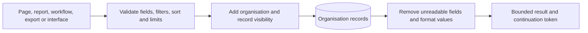
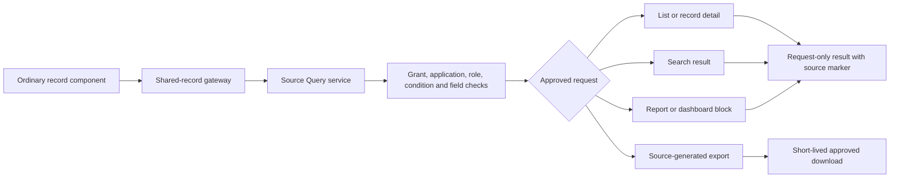
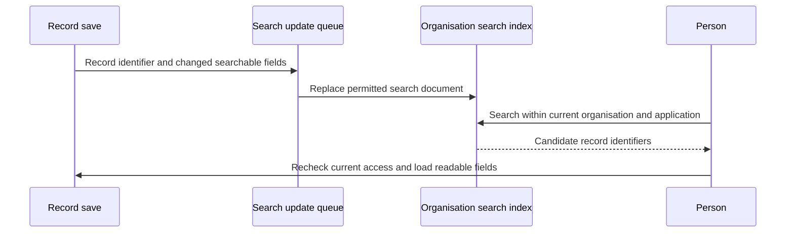
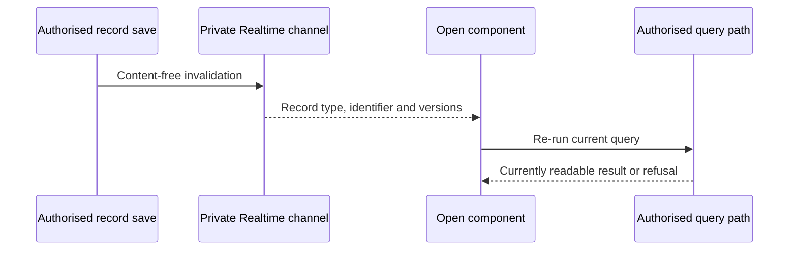

# 10. Queries, reports, search and live updates

[Previous: Workflows and process pipelines](09-workflows-and-pipelines.md) · [Specification index](README.md) · Next: [Files and attachments](11-files-and-attachments.md)

## One read path

Lists, dashboards, reports, workflow selections, exports, programmable interfaces, and search all use validated read contracts and [access](04-access-and-permissions.md). None may bypass record visibility or field permissions. A system module's read-only [system record type](appendices/core-contract-boundary.md#system-modules) is read through this same closed contract: organisation isolation, field permissions and the viewer's current authority apply before any row, count, group or total is produced, and its protected operation remains the only write path. A system record type adds no separate reader, endpoint, materialised copy or cross-request cache, and a query over one always bypasses the cross-request data-result cache ([runtime and caching](17-runtime-storage-and-caching.md#cache-model)).

## Query contract

A query names:

- One record type.
- Fields to return.
- A typed filter tree.
- Optional grouping and totals.
- A stable ordered sort.
- A bounded page size and continuation token.
- At most two declared relationship hops.
- The application and published definition version where relevant.

Every selected, filtered, grouped, totalled, or sorted field must permit that operation in its [field definition](05-modules-fields-and-relationships.md). An invalid or unsafe filter refuses the entire query. The platform never removes an invalid condition and runs a broader query.

The published selected-field list is an explicit record projection. On a grouped
Query, it may include card/member fields as well as the grouping key. Grouped
sorts still name grouping keys, and a summary returns only its declared grouping
keys and aggregates; adding selected member fields does not add them to summary
output.

A module-exposed query is this same closed query contract published under a stable module-owned identity and exact release. A flow may invoke only a query exposed by its resolved module dependency; it cannot supply raw SQL, broaden the projection, or infer a query from a label. The query executes for the flow's Access-resolved effective actor. If a different initiating viewer receives its result, the runtime applies the viewer's current readable projection before returning it, and any later write is authorised independently. [Query execution #54](https://github.com/Abzum-NZ/Abzum-Vortex/issues/54) owns the actual protected Query execution and receipt boundary; [record actions and events #50](https://github.com/Abzum-NZ/Abzum-Vortex/issues/50) owns record-operation and event declarations. These target flow semantics do not claim either runtime is delivered.

A flow's Query node publishes exactly one `ProtectedOperationReference`, containing the query's owning Application or Module and its permanent query ID. That reference is part of the node's exact release mapping, so a grant cannot be reused for another node or query.

## Query exposure

Every Module query declares `exposure`: `private` (the default a new query gets) or `exposed`.
The Application that owns the Module reads all of its queries. An Application that only uses the
Module reads its exposed queries and nothing else. One rule decides it in every place: the Studio
data picker and its store-time check offer only exposed queries of used Modules, the draft compile
and publication validation refuse a page, block or interface that names a private query of another
Application (`vortex.definition.application_query_exposure`), and the database query preparation
refuses to read it, so neither a hand-written request nor a release compiled before exposure
existed can bypass it. A published Application release pins the exact Module release it was
compiled against: when the owner makes a query private, a release that already reads it keeps
reading that pinned, exposed revision, and the borrower's next publication is refused with the
query named, so nothing breaks silently. A
record type's own listing is not an authored query and follows record access. Studio's Data tab
lists the Application's queries ("This app", with an Expose switch) and the exposed queries of the
Applications it uses ("From other apps", read-only), each with its record type, inputs and uses.

## Exact field values in queries

Read value meaning from the exact published Module contract and its field settings,
as defined in [Record value formats](05-modules-fields-and-relationships.md).
For the current Module contract, decimal values travel as exact decimal text but filter, sort and
aggregate as numbers: `2` precedes `10`, not the reverse. Do not convert them
through a JavaScript floating-point number, including in continuation tokens or
returned totals. Text fields containing the same characters remain text.

Money results retain both exact amount and resolved currency. Amount comparisons
follow the [Rule semantics](https://github.com/Abzum-NZ/Abzum-Vortex/issues/44):
equality includes currency, and ordering amounts across currencies is refused.
The existing mixed-currency total refusal below remains unchanged. Query, Rule
and database-backed conditions must agree for the same typed operands. Formatting
for display never changes filtering, ordering or the stored value.

Module query minimum and maximum also accept declared text and yes/no fields.
Text uses Unicode code-point ordering without normalization or case folding;
yes/no orders `false` before `true`. Each result retains the selected scalar,
including empty text or `false`, in the existing `completed`/`value`/`valueCount`
envelope. Absent, null and withheld field values do not contribute; an empty
minimum or maximum returns `null` with `valueCount` zero. The same semantics
apply to readable in-memory arrangements, protected summaries and board metrics.
Sum and average still require whole numbers, decimal numbers or money for ordinary
fields. Installed Summary and Board placements accept a same-record calculation
only when its expression is numeric, its evaluation is explicitly stored, and
its result type is `whole_number` or `decimal_number`; they use the matching
whole-number or decimal aggregate rules. Board metrics apply those rules to
global, column and unassigned results. When an aggregate source is derived, all
candidates go through `read_record`, so a hidden calculation operand or
related-total dependency contributes no value. Total sources, money calculations,
omitted or read-time calculations, nonnumeric calculations, and complex derived
grouping remain unsupported. The field-less `count` descriptor is unchanged.

These requirements belong to [Query execution #54](https://github.com/Abzum-NZ/Abzum-Vortex/issues/54)
and its real storage path, not to a browser-only correction after rows are paged.

## Pagination and limits

- Results use stable continuation tokens rather than unbounded offsets for large datasets.
- A stable unique tie-breaker is appended to every sort.
- Page-size limits depend on the calling surface and are listed in the [data contracts](appendices/data-contracts.md#query-limits).
- Counts and totals use the same access scope and filters as the rows.
- A database-backed summary examines at most 100,000 candidate rows per request (`summary_candidate_limit`). Above that ceiling it returns the neutral `dataset_limit_exceeded` refusal without groups or totals.
- Exports and workflow loops page through the same query contract rather than requesting an unlimited result.

## Records table grid features

The Records table grid itself (columns, sorting, density, sticky headings, resizing, reordering and showing or hiding columns) is always available. Everything else is an optional **grid feature**, authored in the table's one `features` setting group as `{ enabled, ...its settings }` and off by default: search, column filters, saved views, bulk actions, inline editing, related records (master/detail), tree data, column pinning, conditional formatting, pivot and board. Later features (grouping, totals, conditional formatting, export) join the same gate.

One gate decides every feature, in three places that cannot disagree:

1. **Capability check.** Each feature has one check over the bound query's facts: its selected fields with their type and sortable, filterable and searchable flags, choice sizes, relationships and the record type's named actions. It answers "Available" or "Not possible" with one business sentence, for example "Column filters need a field the query can filter by." or "Stage cannot be filtered: it is not selected by the query." Studio runs it on the draft beside each feature's switch; publication runs the same check on the compiled release and refuses with the same sentence.
2. **Server projection.** Every table read projects the features this viewer may use now: authored on, published, and permitted under the viewer's current access and field policy (a filter on a field the viewer may not read, a bulk command no row allows, or an inline edit of a field no row lets the viewer change is not projected). The projection travels in the table payload; it adds no request, and a table with every feature off carries none. Any feature request that is not projected on (a search, a filter, a bulk command or an inline edit, including one sent to the flow route) is refused with the neutral refusal and its cause is logged.
3. **Lazy code.** The browser downloads a feature's code only when the projection turns it on; a table with every feature off loads none of it.

A feature that is off holds only its switch, so it compiles to nothing: its flow bindings are not compiled and its controls never render.

### Board

The Board feature turns the Data grid into a board: one column for each stage of a pipeline, a card for each record. There is no separate board block; the grid reads the one board engine below. The feature names the **column field** (the stage field of a pipeline), the **card title** field, up to **three card fields**, optional **column totals** (the bound query's own aggregates, computed on the server) and an optional **card limit** that warns when a column holds more cards. The bound query must be grouped by exactly the column field, read no linked records, select every card field and read 1 to 200 cards at a time; Studio binds the grid to such a query when the pipeline is chosen. The capability check refuses with the part that does not fit: "Board needs a stage field", a field with no pipeline, one that is not filterable, a query not grouped by the column field, a card field the query does not select, or a total the query does not declare. Only the columns on screen are read: each visible column loads its count, totals and first page of cards when it scrolls or switches into view, a column off screen shows only its name, and "Show more" reads the next page of that one column; counts and totals come from the server. A total over a field the viewer cannot read on some of the column's cards is shown as unavailable, never as a partial total. Dragging a card, or its Move to menu, saves the card's new stage through the board's `card_moved` flow, so the pipeline's moves, the stage's named action and the viewer's permissions apply and a refused move returns the card to its column with the rule's message. A board is never shown on a public page. On a phone one column shows at a time with a column switcher.

### Inline editing

Inline editing lets people change chosen values of a record in the table cell. The feature names the **fields** people may change and the **action that saves a change**: the workflow Studio adds for "When a value is edited", which saves the one changed field of one record through the one Save record task, so the field's validation, the before-save rules, the record's revision check and the Activity entry are the same as for an edit form. A text, long text, email, phone, web address, whole number, exact decimal, yes/no, choice, date or date-and-time field can be edited; a calculation, total, generated number, money value, link, formatted text, several-choice, table or attachment field is read-only here. The capability check refuses with the part that does not fit: "Inline editing needs at least one stored field of Opportunity that people may change", "Value is calculated, so it cannot be edited here" or "Name the action that saves a change".

A cell edits the **stored value** the server sends for that field on that row (an exact decimal as its canonical text, a date as an ISO date, a date-and-time as an instant shown and typed in the display time zone, a choice as its option), never the displayed text. Only a field the viewer may read, may change on that row now, and the installed definition describes an editor for is projected, with its limits (required, length, range, steps, decimal places, offered options). The client only stops obviously wrong input; the protected writer validates every value again.

Enter (or a click) starts an edit, Enter commits once, Escape cancels, and Tab completes the edit and returns to grid navigation; leaving the control commits it. One commit is one `inline_edit` event carrying the record, the one changed field with its new value, the revision the row was displayed at and one command identity, so a repeated request is the same write and one Activity entry. The server refuses, before any flow starts, an event for a table whose feature is off, a field outside the authored list, a field the row does not let the viewer change, or several fields at once. Nothing is shown as saved before the server confirmed the write. A refusal or a failed rule stays on the cell, announced to assistive technology, with the draft kept. A record that changed in the meantime keeps the draft too and offers Reload; Retry becomes available only once the row has been read again, and is a new commit at the refreshed revision, never an automatic replay. The table re-reads its page once after a saved commit and never writes in the background.

### Related records (master/detail)

A row expands to the records of another record type that link to it, for example a company's opportunities. The feature names the **link** from the related record type to the table's record type, the **related records query** of that record type, the query's **input bindings** and the **related columns** (fields that query selects), and reads **at most 40 related records at a time** (Studio starts at 10). The query's inputs bind through the one parameter-binding contract every data block uses; one input is bound to **This row** (the row's record, or one of its fields), which only a row's related records offer. The capability check refuses with the part that does not fit: "Related records need a link from another record type to Company", "Opportunities of one company does not read Contact", a column the query does not select, a page size above 40, a binding the binding check refuses, or a query with no input bound to This row.

At run time a row expands only when the projection says rows expand. Each expand reads one page of that row's related records on the server, and each "Show more" reads the next page with the continuation token the Query engine sealed for that read; collapsing a row and drawing the page read nothing, and a hidden or collapsed row fetches nothing. The browser sends only the table's placement, the row's record identity and the token: the server projects the page again for the viewer (the table must still be on it and usable), reads the row again under the viewer's current access (a row the viewer cannot read is refused), resolves the query's inputs with This row set to that row, and runs the related records query through the protected Query engine with only the related columns, under the viewer's field policy (a withheld value shows as Restricted). Link titles, including each related record's own page address, are read in one batch. A refused read shows "You do not have access to these records" and logs the cause. At most three rows are expanded at once: opening a fourth collapses the oldest and says so. Related rows do not count towards the table's page budget.

### Tree data

A record type that links to itself (a company's parent company) can show its records as a tree. The feature names the **parent link**, a one-record link from the table's record type to the same record type that is one of the query's columns, and reads **at most 200 child records at a time** (Studio starts at 40). The capability check refuses with the part that does not fit: "A tree needs a link from Company to Company among the query's fields", a chosen field that is not such a link, a grouped query, a page size above 200 or the bound query's page limit, a table page and child page that together exceed the 200-row budget ("A tree table shows at most 200 rows at once: ..."), Board, or Related records switched on at the same table (a row opens one panel).

A one-record link from a record type to itself can never make a record its own ancestor. The record writer, the single place a link is written, refuses a record that would become its own parent or the parent of one of its ancestors, and the save is corrected on the parent field ("Parent company cannot be this company or one of the records beneath it."). The check runs after the writer holds the link's edge locks and serializes parent changes for the organisation and relationship; a concurrent change waits for the other save and then walks the committed links, so two re-parentings cannot close a loop together. The ancestor walk has no depth cutoff.

The table's own page lists the **roots**: the records with no parent and the records whose parent the viewer cannot read, so a record never disappears and its unreadable parent is never revealed. Opening a row reads **one page of its children** (one read per open and one per "Show more") through the table's own read, in the table's sort and with the table's columns, formatting and field policy. Every child is decided under the viewer's current access like any row of the table; the parent needs no read of its own, because a child whose parent the viewer cannot read is already a root. Every row says in the same read whether the viewer may read a child of it: the whole page is decided at once with a bounded number of statements, never one per row, and the answer counts only children the exact access decision allows. The parent link must be a field every reader of the type is guaranteed to see, so a hidden parent never decides which rows are listed; a viewer who may not see it on every record it may read has no tree, and the table lists its records flat as it does without the feature. Rows the table's query leaves out are not shown, and neither are their children. A row with nothing to open shows no toggle.

The table holds **at most 200 rows at once**, its page and every level opened beneath it; each child read requests only the room remaining in that budget, reserving it before the request starts. Keyset continuation positions stay valid when a later page needs a smaller size. A full table waits until a branch is closed, and closing a branch gives its rows back. The grid is a tree grid: rows say their level, the toggle is exposed as expanded or collapsed, and the right and left arrow keys open and close the row under the focus. While the viewer searches or filters the table, it lists the matching records flat, as it does without the feature, so a match whose parent does not match never disappears; no ancestors are walked. Clearing the search and filters shows the tree again with every branch closed.

### Pivot

A pivot shows the table's filtered records as **rows** crossed with **columns**, each cell one **measure**: a count of records, or the total, average, lowest or highest of one number or money field. It is a view of the same records, opened from a **Pivot** switch in the table's toolbar and kept in the page address as `pivot.<placement>=on` (with `.<cursor>` for the first row of the page); opening, paging or closing it is not a change of the table's query state and reads no table rows.

The rows and the columns are two different choice, link or date fields the bound query selects and people can filter by; a date field is grouped by a calendar unit (day, week, month, quarter or year) in the organisation's time zone, through the same date buckets as grouped grids. A choice field with more than 50 choices cannot be the column dimension. The measure field is a stored number or money field, not a calculation or a total. The capability check refuses with the part that does not fit: "A pivot needs two choice, link or date fields of Opportunity that people can filter by", "Stage has more than 50 choices, which is too many for a pivot", "Choose whether the columns group Close date by day, week, month, quarter or year", "Choose the number or money field each cell totals", or a page size outside 1 to 200. Studio draws the settings with its field pickers restricted to the fields that fit, so it offers only fields a pivot can use. Linked targets are checked in one protected batch per dimension before grouping; unreadable targets fold into one "Not available" value. Visible linked headings use the ordinary protected title resolver.

There is no second pivot path. The browser sends the table's placement and an opaque row position; the server projects the page again for the viewer, reads the table's own search and filters from the page address through the one table state codec, resolves the query's inputs, and calls the protected summary with a `pivot` descriptor. The database runs **one statement** over the readable filtered set with grouping sets: every cell of the page's rows, every row total, every column total and the grand total. Averages and extremes are computed for each set, never combined from cells, so totals match an independently walked aggregate. Rows are keyset-paged by their canonical value (40 by default, at most 200); the column dimension is capped at 50 values over the whole filtered set. Above the column cap the summary returns the neutral `pivot_columns_exceeded` refusal and above 100,000 candidate rows `dataset_limit_exceeded`; the table shows a business sentence, for example "This pivot has more than 50 column values, which is too many to show. Narrow the records with search or filters.", and never a partial pivot. A row or column dimension or a measure the viewer cannot read on every record is refused (`field_unbounded`), so a withheld value never appears as a row, a column or a measure. A record with no value for a dimension forms the "Not set" row or column; a record whose dimension field is withheld forms none. A money measure over mixed currencies shows "Mixed currencies" for that total, never a sum across currencies.

A click on a row heading, column heading or cell opens the ordinary grid on exactly the records it counts: the server returns the typed filters (a choice value, linked record, empty value, or the calendar days of the bucket) as the table's own filter spelling, and one address change applies them and closes the pivot, so one bounded page read follows. A heading offers this only when Column filters includes its field; "Not available" linked headings and cells without records offer nothing. An empty-value filter is encoded as `empty:` and uses the shared `is_empty` condition.

### Column filter semantics

A column filter is typed by the field's **canonical type**, never by its display format, and each filterable field holds at most one filter:

| Field type                                                   | Filter                                                                                                                                                              |
| ------------------------------------------------------------ | ------------------------------------------------------------------------------------------------------------------------------------------------------------------- |
| Text, long text, email, phone, web address, reference number | Contains the text (at most 200 characters).                                                                                                                         |
| Choice, several choices                                      | Any of the chosen options (OR within the field); choosing none clears the filter.                                                                                   |
| Whole number, decimal number                                 | An inclusive range of exact decimals; either end may be open. Values are exact decimal text, never floating point.                                                  |
| Money                                                        | An inclusive amount range in one named currency (the field's fixed currency when it has one); a value in another currency is outside every range.                   |
| Date                                                         | An inclusive range of calendar days; either end may be open.                                                                                                        |
| Date and time                                                | Whole days in the organisation's time zone: from the first instant of the start day (inclusive) to the first instant after the end day (exclusive).                 |
| Link                                                         | Any of the chosen records, picked through the protected bounded record picker under the viewer's access; their titles are read in the page's one batched link read. |
| Yes/no                                                       | Equals yes or no.                                                                                                                                                   |

Calendar day boundaries, date-time column filters and relative date-time query inputs use one
ISO calendar conversion in the organisation's named time zone. A skipped midnight uses the first
instant of that day, a repeated midnight uses its first occurrence, and a skipped day has the same
boundary as the following day. Calendar years below 1000 retain their leading zeroes, and era
changes preserve astronomical year numbering (year 0000 precedes year 0001).

Generated UTC endpoints must fit the shared instant parser's four-digit years, 0000 through 9999,
including its six-digit fractional precision. The maximum canonical UTC instant is
`9999-12-31T23:59:59.999999Z`; an exclusive boundary beyond it is refused, never clamped to that
instant or replaced with today's date. For example, the boundary after 9999-12-31 is out of range
in UTC, but remains representable in a zone whose positive offset places it in UTC year 9999.
Calendar views additionally require their local start and exclusive end dates to fit the calendar
date contract (0001 through 9999); a period crossing that domain is refused explicitly. A date-time
column filter whose boundary falls outside the UTC instant domain refuses the read.

Calculated fields, totals and other types take no filter. The filters of different fields AND together and AND the published query filter, so a filter only ever narrows the query. The page address carries each filter as `filter.<placement>.<field>=<kind>:<operand>` (one codec for the runtime, the address, saved layouts and Studio preview); a malformed, inverted, open-on-both-ends or repeated filter refuses the read rather than being dropped. The server rebuilds every condition from the installed field (type, options, currency and link target) and refuses a filter on a field the feature does not declare, a field whose filter kind does not match its type, or a feature that is not projected on. A field the viewer's current field policy withholds is not offered, and a forged filter on it is refused by the Query engine. A committed filter is one bounded read of that table only, from page one with the selection cleared; text commits after a 300 ms pause, and a reply for an earlier state is discarded. Every supported filter, money ranges included, is pushed into the indexed candidate scan when its field is readable for the whole record type.

### Column menu and toolbar

Each column heading has one menu, opened by its chevron, Enter or Alt+Down (Escape closes it and returns to the heading). Its core items are always offered where the column supports them: Sort ascending, Sort descending, Add to sort and Clear sort (Shift+click or Shift+Enter on the heading also adds a sort key), Move left, Move right and Hide column. A column whose **Auto-size** setting is on (off by default) also offers Auto-size column, which fits the column to its heading and the cells of the page on screen, within the column width bounds, and stores the width in the person's layout; its code loads only when such a menu opens. Grid features add their own items to the same menu through the feature registry, only when the viewer's projection turns them on.

The table has one toolbar in a fixed order: the projected features' items (search, filter chips, the view switcher), row density, Columns, then export and Full screen. There is no authored toolbar list: an item shows only when its feature is projected on, while density, Columns and Full screen are the table's own. On a phone the table's own controls fold into one More menu. **Allow full screen** (on by default) offers a Full screen button (Ctrl+Shift+F): the table fills the window as an in-app layer, and the browser's full screen is requested too where allowed; Escape or the shortcut leaves it and focus returns to the button. Entering or leaving keeps scroll, selection and an open editor, and reads nothing. Layout actions (density, hide, move, auto-size, full screen) read no records; a sort reads one bounded page, and the server re-checks that every sort key is sortable.

## Saved views

A saved view records the whole state of one table: column order, visibility and widths, density, the ordered sort, one typed filter per field and the search (grouping, pinning and the like join the same document as their features land). It stores configuration only, never rows, a cursor, a page or a permission. Views live in the one grid view store, next to the person's current layout, isolated by organisation account, application installation, page and placement; deleting the account or the installation removes them.

A view is **personal** (its owner only) or **shared** with the whole organisation, chosen roles of the application, or groups. Sharing, and changing or deleting a shared view that is not one's own, requires the platform Share table views permission, granted to roles in Access; the database decides it now, for the person making the request. Recipients see a shared view read-only and can Save as their own copy. Names, shares and deletes are revision-checked: a change made in another tab is refused and the latest version is shown.

Studio can author default views for a role or everyone in the app (`role: "*"`). A role default takes precedence over the app default; a personal layout or explicitly selected view takes precedence over both. Default documents remain on the server. Their filter values pass through the same current field-bound projection as stored views before the selected document reaches the viewer.

Opening a view re-evaluates it under the viewer's current access, field policy and release. A column the viewer cannot see, and a filter or sort key on a field they cannot read, are left out and announced ("1 column is hidden for your role"); a stored filter that is malformed is never applied, which would widen the rows, and the viewer is told the view needs fixing. The address names the view (`view.<placement>=<id>`, with the sort, filters and search it shows), so a copied link opens the same view for anyone who may see it; the address wins over the view's own state, and a view the viewer may not see opens the table without it. The switcher lists Personal and Shared views with search, Save view, Save as, Rename, Share, Delete and Reset to default, and an unsaved-changes dot. Saving, renaming, sharing, deleting and a layout change read no records; opening another view reads the one grid again.

The term **saved view** replaces the outdated terms “prepared list,” “prepared query,” and “prepared view.”

## Arrangements and reports

- A table presents rows and columns.
- A board groups records by a filterable choice field with no more than twelve options.
- A calendar uses the page's explicit start/end or start-plus-duration mapping from [modules and fields](05-modules-fields-and-relationships.md#field-types).
- A summary groups and totals compatible fields.
- A dashboard composes several bounded query blocks.

A protected board-member page uses the same installed grouped Query, typed
inputs, published filter, optional narrowing filter, and current viewer
authority. It requires one filterable choice grouping key and its installed
options, and returns only requested fields from the Query's published selected
projection. The scan orders by protected record identity, never by the choice
value. Membership uses the choice value only when that value is present in the
current readable projection; missing, withheld, null, and undeclared values
belong to unassigned. Its encrypted continuation binds the installed Query
revision, actor and installation, typed inputs, selector, filters, projection,
page size, and record-identity order. Each page rechecks the live installation
and record permissions, and member pages are not cached across requests. This
operation supplies bounded column members.

A protected board summary uses the same installed grouped Query, exact release,
typed inputs, authority and filters. It requires the sole grouped choice field
to appear in the published selected projection and uses its current installed
options in order. It counts every permitted filter-matching row, including
rows whose choice is missing, withheld, null or not an installed option; those
rows share one unassigned bucket. It returns each option and unassigned bucket
even when empty, with the Query's declared aggregates for that bucket and the
same aggregates across all eligible rows. Withheld aggregate values do not
contribute, while their readable rows still count. The operation is uncached,
refuses neutrally above the 100,000-candidate ceiling, and returns no records,
raw groups or option permission identifiers. It does not promise an atomic
snapshot across separate member and summary requests, and it does not compose
boards.

A protected grouped-member page reads one exact group of an installed grouped
Query in record-identity order. Its selector supplies every installed grouping
field once, using the same typed JSON values and representations as the generic
summary. Membership is checked only after the current record read and published
and narrowing filters pass: every grouping value must be present in the current
readable projection and equal the selector value, with JSON null matching only
JSON null. A missing or withheld grouping value belongs to no generic group, and
the grouping fields need not be selected for row output or declared filterable.
The page returns the installed group identity even when it has no rows. Its
opaque `protected-group-members-v1` continuation binds the actor, installation,
release revision, selector, inputs, filters, projection, page size and
record-identity order. Each page rechecks the installation and live record
authority; grouped-member pages are uncached and scan at most 500 candidates
while returning at most 200 rows. This operation returns no group counts or
aggregates and does not compose or place grouped tables.

Every chart or report states its measure, grouping, filter, time zone, and treatment of missing values. A money total is refused unless the filtered group contains at most one currency; no implicit conversion or split result is produced.

## Shared-record reads

A shared-record query uses the same validated query contract whether the source is local or in another cluster. It names the source cluster, source organisation, grant, recipient application, and requested surface. Every returned row retains its source identities and displays a plain source-organisation marker. A query cannot join, group, or total source-owned records with recipient-owned records as though they had one owner, and one query cannot join records from several source clusters.

For a cross-cluster read, the complete filter, sort, field projection, page size, and continuation token are sent once to the source through the [federation query contract](appendices/data-contracts.md#federated-query-and-action). The source validates and executes the query, applies the grant and database row restrictions, and returns only the approved fields. The recipient never fetches a broad remote set and filters it locally, and it never makes one remote call per returned record.

The recipient uses the ordinary list, record-detail, search-result, report, and export components for shared records, so supported work behaves consistently with recipient-owned records. The component obtains an operation-capability description with the result and shows only the fields and actions permitted by the complete grant. Source ownership, temporary unavailability, and any measured remote delay remain visible rather than being disguised as local ownership.

Application search may include a **Shared** result group. The search coordinator asks only the bounded set of active grants known from non-content grant mirrors, runs each search at its source, and merges only the returned approved projections for the current response. Shared content is never written into the recipient search index. An unavailable source produces an unavailable source group; it does not make the whole local search fail or return stale results.

A saved report or dashboard block may use one source organisation, record type, and grant. Its definition may be stored by the recipient because it contains identifiers, fields, filters, grouping, and presentation settings rather than source record values. Rows, counts, groups, and totals are calculated by the source on each run and are not materialised in recipient storage. A report cannot mix source-owned and recipient-owned values or combine several source organisations into one total.

Approved export uses the same source-executed query and field projection. It is described in [record export](16-copying-sharing-import-export.md#record-export). Workflows, connection messages, bulk changes, cross-source relationships, and offline use of live shared records remain outside the first release.

Shared queries bypass the cross-request business-data cache under [runtime and caching](17-runtime-storage-and-caching.md#grant-cache-invalidation). Pagination, counts, and fields are calculated in the source cluster using one independently sufficient active grant; a query cannot combine scope from one grant with fields or actions from another. A source or network outage fails closed and shows that the source organisation is temporarily unavailable; the recipient does not display an older persisted result.

## Search

Search keeps a separate organisation-scoped index built only from fields marked searchable.

- Sensitive fields are never copied into the search index.
- Personal fields are indexed only if explicitly marked searchable and permitted by the organisation privacy policy.
- Results are scoped by organisation, application discoverability, record visibility, and field access.
- A recipient organisation's index never receives another organisation's shared record content. Shared search is executed by the source and merged only into the current response.
- Candidate results are rechecked against current access before display.
- Access removal affects the next search request because results are access-checked at read time. Ordinary record creates and changes appear in search within 10 seconds under normal operation. A delayed index shows a freshness warning and triggers recovery; it never bypasses the current access check.
- Search priority `first`, `normal`, and `last` affects ranking without overriding access.

The local literal-search matcher accepts an optional `expressionMode` with only `literal` and `or` values; omitting it keeps the existing literal AND grammar, and any other value is refused. In `or` mode, an expression is one or more nonempty AND groups separated by an exact uppercase, unquoted, whitespace-delimited `OR` token. Lowercase `or`, quoted `"OR"`, and other punctuation remain literal terms. AND binds within each group, and a candidate matches when every term in at least one group occurs in the current readable requested fields. A quoted phrase must match as consecutive normalized tokens within one field. A malformed quote or empty group refuses the complete expression before candidate text is read. Positive term indices remain global and left to right; separators have no index, and matched fields report actual matches even for an incomplete group. The existing 2,000-character expression, 32-term, 64-phrase-token, and 1,000-candidate bounds and result shape remain unchanged. This local grammar does not define application serving, ranking changes, or the remaining search features.

## Live updates

Live updates use [private Supabase Realtime Broadcast channels](https://supabase.com/docs/guides/realtime/authorization) to tell an open page that relevant data may have changed. They carry organisation, application, record type, record identifier, change kind, data version, and sequence—not private field values. Channel access is protected by row rules on `realtime.messages` and is recalculated when the connection or identity token changes.

The client treats every message as an invalidation only: it re-runs a permitted query or reloads the permitted record through the ordinary server path. Subscription channels are organisation-scoped and narrowly split by application and surface so a connection does not subscribe to an organisation-wide firehose. A shared-record screen may receive a content-free invalidation tied to an active grant, then re-run its authorised source query. A live message never carries source record values, acts as evidence of access, or makes an unreadable record visible.

Business-record changes use Broadcast rather than exposing direct table-change subscriptions to browsers. This keeps payloads deliberate and permits the same content-free message for derived changes, source-owned shared records, and access-version changes. Complicated business access remains in the normal server and database read path rather than in the channel policy.

## Acceptance examples

- An unfilterable address field causes a clear query refusal; the condition is not dropped.
- Search cannot return a record that a direct read would refuse.
- Count, chart, export, and list results agree for the same access scope and filter.
- Pagination neither duplicates nor skips records when several records share the visible sort value.
- Removing access prevents live updates and makes subsequent refreshes refuse the record.
- A captured live message contains no field value and cannot be used to fetch data after access is removed.
- Shared records can use ordinary list, detail, search-result, report, dashboard-block, and approved-export components while retaining a visible source marker and source-authoritative checks.
- Shared search, report, and dashboard results leave no recipient search document, materialised report result, or cross-request business-data cache entry.
- Shared records do not enter workflow selections, connection messages, bulk changes, cross-source relationships, or offline storage in the first release.
- Same-cluster and cross-cluster shared lists return the same fields and refusal meanings for the same grant; only measured latency and source-availability states may differ.

## Page context and derived-value safety

Use [explicit typed binding contexts](appendices/page-builder-contracts.md#data-context-and-related-records) for the page subject, related panels and row items. A valid employee-to-department example does not require every query on the page to target Employees. This is ordinary related-record querying, not permission to join different shared sources.

Evaluate access before grouping, aggregation, counts and pagination. A cached or stored derived result must not expose inputs the reader cannot access. Caller-filtered totals are computed for that caller, not stored as one universal business value. Invalid predicates refuse the affected query rather than being silently dropped.

### Explicit block input bindings

Every query-bound page block maps query inputs through `query_parameters`. Each item names an input and one source: a typed fixed value, a declared page parameter, a readable field of the page subject, the current person, a page control, a relative date, or an authorised parent row inside related records. The same mapping checker supplies Studio and publication messages. No URL name is implicitly a query input.

The server resolves each binding per request. Record fields reuse the authorised subject read; a withheld field is logged without its value and yields `awaiting_input`. Missing required values render the authored awaiting message and make no query. Missing optional values omit their comparison from the query condition, including within conjunctions, alternatives and negation. Additional grid filters only narrow the resulting query. Relative dates use the organisation time zone; date-time inputs receive the start-of-day instant.

Current person supplies a record reference to the signed-in viewer's directory person. Studio offers it only for record inputs accepting that directory type, and publication uses the same type check. The server derives both the installed person type and its record identity from the verified human context, never from a page address or control. A viewer without a directory person is refused, including for optional inputs, so a missing person cannot broaden a "My records" query. Organisation-account-valued inputs are not supported by page bindings.

### Grid grouping execution

Grid grouping is state of the Data grid, executed by `run_module_query_summary` and the protected
`groupedMembers` reader. Query-authored grouping and totals supply defaults; they are not a second
grid engine. Data grid is the only record-table block. Its List preset renders the same bounded
record page as cards at every screen size; Table can use those same cards on phones. Presets write
ordinary grid settings and never select a second query or renderer. The former standalone list
and grouped-data blocks have been removed; grouped preset authoring follows the grid grouping feature.

The protected readers accept `grouping: { fieldId, limit, dateBucket? }` to replace those defaults
with one query-selected, filterable dimension. A choice field has at most 50 options; a lifecycle
stage uses its canonical choice field identity, never its label. A date or date-time field requires
`dateBucket: { unit, timeZone }`, with a day, week (Monday start), month, quarter or year unit and an
explicit recognised time zone. Date-only values retain calendar dates. Date-time values bucket the
stored instant in that zone and return the bucket's start as canonical UTC, independent of session
time zone or display format. Both readers refuse this override unless the field is guaranteed
readable under the current read plan.

The authored `limit` is 1–200 groups. A summary returns only that page of groups, ordered by its
canonical JSON group key. `nextGroupKey` is the last visible key when more groups exist and null
otherwise; the next request supplies it as `groupAfter`. Each page rechecks current access and
recomputes counts over the complete filtered set. `totalRowCount` and aggregate totals do not shrink
to the visible group page. The summary retains the 100,000-candidate ceiling and returns a neutral
`dataset_limit_exceeded` refusal above it. Counts describe the currently readable result,
independently of a later member page.

Summary and member requests carry the same resolved query inputs, narrowing filter and search.
Search matches only the current readable scalar or choice-array values of fields the record type
marks searchable. A component's searchable-field set may narrow that set; an empty set searches all
searchable fields. Summary search uses per-record access decisions, retaining the candidate ceiling
before it reads records. It does not derive counts from a loaded member page.

Generic member pages take the ordinary ordered sort contract and forward/backward keysets. They
carry at most 200 records, with only the requested field projection. Choice grouping narrows the
candidate scan by its stored key; date grouping uses typed half-open calendar ranges. Instant
grouping widens the index range around the bucket boundaries and applies exact authored-zone
bucket equality before the candidate page limit, so repeated local midnight retains both
occurrences (including 23/25-hour DST days). These predicates apply only after guaranteed
readability is established, then membership is rechecked by the same canonical bucket operation
on the current readable record. A noncanonical bucket start is refused. JSON null denotes the unassigned group; a missing or
withheld value never establishes generic group membership. Continuations bind the actor, scope,
release, query, resolved inputs, exact selector, grouping dimension/bucket/zone/cap, sort, filters, search, projection,
page size and direction. Member reads remain uncached.

These reader capabilities are the execution foundation of #3027 and the date/group-cap part of
#3032. Link dimensions still require permitted batched titles and neutral unreadable-target groups;
they are refused as grid overrides until that support lands. The grid feature gate, Studio
controls, single URL codec, group headers and active-group interactions are supplied by that
feature's UI/runtime integration, rather than inferred by the query readers.
