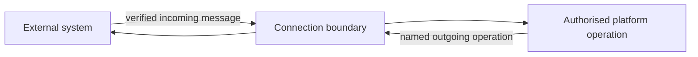

# 12. Connections and interfaces

[Previous: Files and attachments](11-files-and-attachments.md) · [Specification index](README.md) · Next: [Activity history, privacy and retention](14-activity-privacy-and-retention.md)

## Connections

A **connection** lets an organisation call or receive messages from another system. Connections are
platform catalogue data plus organisation-owned instances; there is no customer-authored interface
language.

## Connection types and connection instances

A platform-catalogue **connection type** defines:

- Human-readable purpose and provider.
- Authentication method and secret fields.
- A reusable catalogue of named input and output shapes. Each shape contains uniquely named, typed
  fields and may be empty for a no-content operation. Field types are `text`, `whole_number`,
  `decimal_number`, `yes_no`, `date`, `date_time`, `record_reference` and `json`; decimals use exact
  decimal text.
- Named outgoing operations with address templates, method, resolved input/output shape keys,
  timeout, retry policy, and allowed response size.
- Named incoming message types with signature verification, replay window and resolved input shape.
- Allowed destination hosts and redirect policy.
- Health-check and revocation behaviour.

Each connection-type release fixes one provider. If the platform adds another provider later, it
publishes that provider as its own connection type. Webhook destinations may use only platform hosts
allowlisted by the catalogue; customer-chosen hosts are out of scope.

An organisation-owned **connection instance** selects a connection type and stores its encrypted
credentials, granted applications, status, last successful check, and authorised administrator.
Secrets never appear in definitions, exports, activity content, flow inputs, logs, or browser
responses.

An application connection binding records the permanent connection-type identifier, an accepted
version requirement, the exact resolved catalogue version, and the operation keys the application
requires. Publication requires the exact compiled connection artifact from the caller's immutable
resolution snapshot, checks that the declared requirement accepts the resolved version, and compares
the snapshot and compiled operation catalogues in both directions before resolving every required
operation against both. Missing, foreign-snapshot, altered, or partial connection artifacts are
refused. This makes the application reproducible without embedding a connection instance or secret in
its definition.

The administration surface creates, edits and revokes instances, stores secrets in Vault through a
write-only reference, and runs bounded health checks through a runtime-only execution ticket. No
provider adapter is registered yet; a health check reports "No adapter available". Flow calls to
connection operations are not available in the current flow contract, and incoming messages do not
start flows.

## Authorisation lifecycle

Password-like keys and [OAuth 2.0](https://oauth.net/2/) grants are created through a server-side
flow. The platform records grant time, granted scopes, expiry, refresh state, and revocation. Refresh
is locked so parallel work does not race or reuse a rotated token. Revocation immediately prevents new
calls.

## Outgoing call safety

- Only a named operation from a granted connection instance can be called.
- The caller supplies an explicit input map; every required shape field is present and no undeclared
  field is accepted.
- The destination host comes from the platform-catalogue allowlist, not from record output.
- Addresses are revalidated after redirects and name resolution to prevent access to loopback,
  link-local, private infrastructure, metadata services, and unapproved ports.
- Requests have bounded time, size, redirects, attempts, and response parsing.
- Logs redact credentials, signed addresses, sensitive headers, and configured sensitive response
  fields.

## Incoming message safety

- The boundary verifies signature, timestamp, content type, size, and source policy before parsing
  business content.
- A provider message identifier or deterministic checksum prevents duplicate processing for the
  selected retention period.
- Verification failure returns a neutral response and does not reveal organisation configuration.
- Incoming content is untrusted input and cannot select an arbitrary connection, destination, or
  permission.

## Public forms

Public pages use explicitly published operations, approved fields from
[public access](04-access-and-permissions.md#public-access), abuse controls, and neutral responses. A
public operation binds a published frontend flow entry point under the same one start path and never
targets a lower-level operation directly. A public operation and its target action must use
non-administrative permissions. Its subject must resolve, and every subject field read by its
condition or values and every field it changes or creates must be approved for public display on the
correct record type. Public relationship copying is refused because the public-surface contract has no
relationship allowlist. Public callers never receive a general organisation token or an
interface-discovery catalogue.

## Acceptance examples

- A record value cannot redirect a connection call to a private network address.
- A connection definition with a missing shape, duplicate shape field, or undeclared flow input is
  refused before publication.
- Replaying a valid incoming message does not duplicate work.
- Revoking a connection prevents later attempts from using cached credentials.
