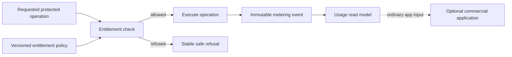
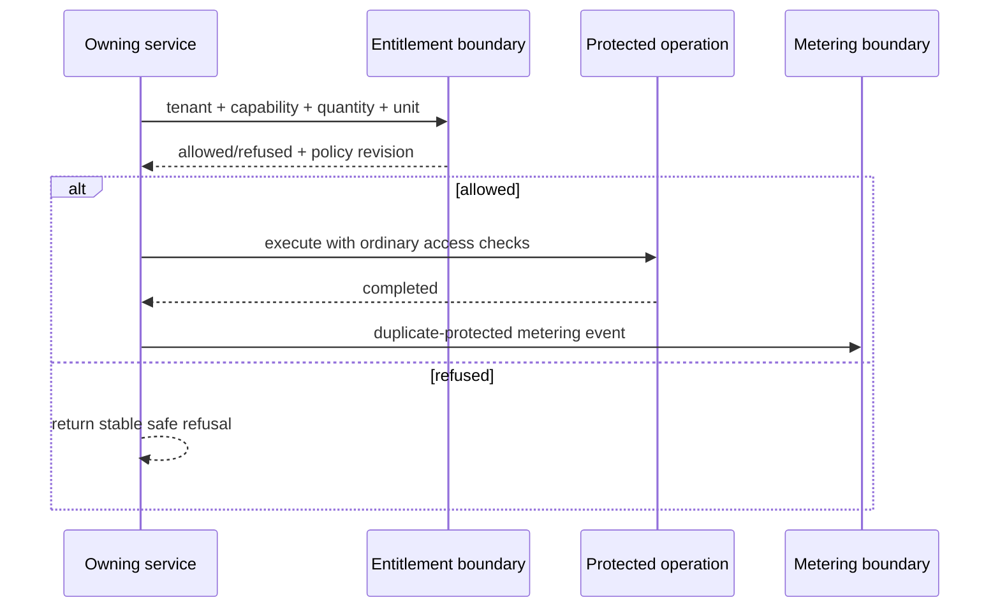

# 15. Entitlements and metering

[Previous: Activity, privacy and retention](14-activity-privacy-and-retention.md) · [Specification index](README.md) · Next: [Copying, import and export](16-copying-import-export.md)

## Purpose and boundary

Vortex may need to allow or refuse a platform capability and measure resource consumption. It does not need to understand pricing, subscriptions, invoices, payment providers or how an entitlement was obtained. Those are ordinary applications under the [core contract boundary](appendices/core-contract-boundary.md).

An **entitlement** answers whether a tenant may use a named platform capability and, where relevant, how much may be used. A **metering event** records an accepted quantity attributed to a tenant and optionally to the organisation that caused it. Neither concept carries money or commercial status.

## Entitlement decision

The requesting service supplies the tenant, optional organisation attribution, namespaced capability key, requested quantity, unit and correlation identifier. The entitlement owner returns one versioned decision:

- `allowed`, with the accepted quantity and optional remaining quantity; or
- `refused`, with a stable safe reason code.

The decision contains the policy revision used. A service never infers entitlement from a commercial record, payment-provider message or banner. Security and record access are separate checks: an entitlement can refuse an operation but can never grant data access.

Every protected flow task that consumes a limited capability performs the same current entitlement check and metering composition as a direct call to its owning service. A flow step never widens or bypasses the tenant entitlement; sequential steps meter only their own committed operations.

## Metering events

Each accepted event has a caller-minted identifier, tenant, optional organisation, capability key, positive quantity, unit, occurrence time, optional source event, correlation identifier and acceptance time. Replaying the same event identifier returns the stored event without counting consumption twice.

Metering is generic evidence. It may support capacity planning, fair-use controls or an ordinary commercial application, but the core ledger never marks consumption as chargeable and never creates an invoice.

Corrections are explicit later events or protected reconciliation operations; history is not edited in place. The exact reservation strategy for scarce concurrent resources is delivered with the entitlement service and must preserve the same allow/refuse boundary.

## Decided, not built

Entitlement ceilings are decided, not built. The decided design has two levels of authority: the configured system operator defines and publishes entitlement policies and retains the context-free tenant-ceiling bootstrap, and an active named Vortex super administrator may set, re-pin or revoke a tenant ceiling after recent primary authentication. `platform.tenant.capability_limits.allocate` authorises setting, lowering and revoking a tenant or organisation allocation; `platform.tenant.capability_limits.read` authorises reading it. The effective limit is the lowest of the platform ceiling, the tenant allocation and the organisation allocation, and an allocation can never raise a limit above its ceiling. Policy publication, ceiling changes and allocation changes are protected operations with activity evidence. No entitlement service, ceiling operation or allocation permission is wired into a live consuming operation yet.

## Explicit exclusions

- Pricing, products, plans, subscriptions, trials, invoices, refunds and payment methods.
- Provider-specific customer, product, price, invoice or subscription identifiers.
- Payment-failure grace periods or cancellation retention.
- Active-person charging rules.
- Tenant, organisation or application announcement records.

These exclusions do not prevent Abzum or a customer from building those capabilities as ordinary Vortex applications.
