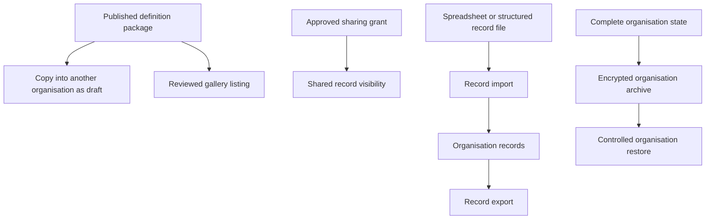
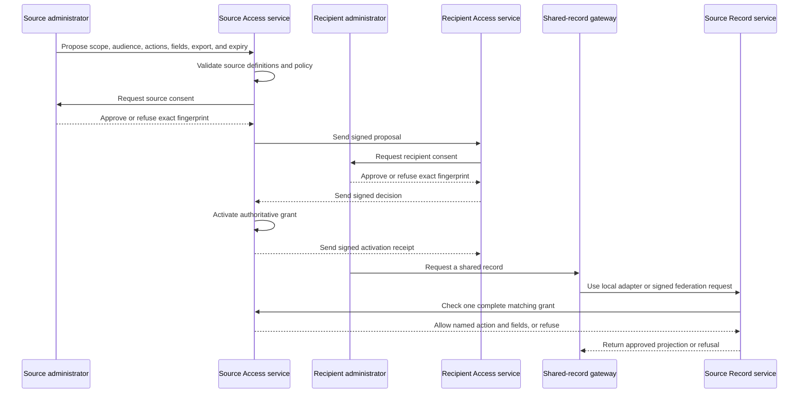

# 16. Copying, sharing, import and export

[Previous: Entitlements and metering](15-entitlements-and-metering.md) · [Specification index](README.md) · Next: [Runtime services, storage and caching](17-runtime-storage-and-caching.md)

## Five distinct operations

The platform separates definition copying, gallery distribution, record sharing, record import/export, and complete organisation backup transfer. They have different safety and completeness requirements.

## Definition packages

A package contains published [modules or applications](03-composition-and-publication.md#definition-ownership-and-versions), a manifest, dependency ranges, stable identifiers, source version, publisher, content fingerprint, required capabilities, and installation notes.

Flows are copied or installed only as part of the immutable release of the module or application that owns them; every flow has exactly one owner. Neither operation copies a live specified-user/system execution grant, and a missing or incompatible flow dependency leaves the candidate unready rather than substituting another version.

A package never contains organisation records, organisation accounts, secrets, access tokens, private files, commercial-system identifiers, activity history, or live connection instances.

## Copying between organisations

Copying creates drafts with new organisation ownership. Before creation, the platform shows:

- Included roots and components.
- Existing dependencies that can be reused.
- Missing modules, themes, connection types, interfaces, roles, blocks, or capabilities.
- Identifier collisions and proposed remapping.
- Connection instances, secrets, public addresses, organisation-specific recipients, and file references that will be cleared.

The copy is always an incomplete draft and never publishes automatically. Every missing dependency must be installed, mapped to a compatible local dependency, or explicitly removed with its affected components. Validation and publication remain blocked until the dependency report is empty.

## Gallery

A gallery listing references a reviewed package version and displays publisher, purpose, required capabilities, requested permissions, dependencies, release notes, and support status. Installation uses the same preview and validation as direct copying.

Removing a gallery listing does not remove installed definitions. A security withdrawal can prevent new installs and warn affected organisation owners without silently changing their live applications.

## Installing and updating an application package

Copying and installation are distinct. Copying produces an incomplete editable draft. Installing selects one exact immutable package and dependency set for one organisation, records one installation identity, and prepares every required runtime integration before that installation becomes ready. Publication alone never installs, updates, or deploys the package.

When the application contains durable workflows, installation or explicit upgrade uses the private [workflow registration protocol](09-workflows-and-pipelines.md#installation-registration-and-activation). The adapter generates only the published typed flows, registers their exact application and workflow versions into the shared Kestra instance, and verifies every fingerprint while the candidate is inactive. Vortex activates the installation revision only after definitions, dependencies, permissions, storage changes, and all workflow registrations are ready. No browser-supplied YAML, mutable label, Kestra identifier, or customer-held workflow credential is accepted.

This is all-or-nothing Vortex readiness, not a claim that Vortex and Kestra share a database transaction. Stable environment, organisation, installation, application, workflow, and revision identities make retry converge without duplicate flows. If first installation fails, it remains not ready. If an upgrade fails, the existing active version remains current. Prepared but unactivated flows cannot start because runtime and schedule paths recheck the current active installation.

Older registered versions remain available to explain accepted starts and complete in-flight runs. An explicit rollback activates a previously verified compatible package through the same review and checks. Uninstall blocks new acceptance through Vortex immediately, records a refusal or cancellation for accepted work that has not begun, preserves installed, intent, and execution history, and reconciles external schedule deactivation without pretending that deleting a Kestra flow reverses completed work.

## Record sharing

Record sharing makes records owned by one organisation or application available to an approved recipient without copying or transferring ownership. It is distinct from definition copying, gallery distribution, record import/export, and whole-organisation restore.

The user has one sharing experience whether the recipient is in the source cluster or another Vortex cluster. The product never asks the user to choose a transport. The shared-record gateway resolves the organisations and selects either the local adapter or the signed [Vortex Federation API](17-runtime-storage-and-caching.md#vortex-federation-between-clusters).

The source cluster remains authoritative in both cases. A cross-cluster response may travel through the recipient service and browser for display, search, reporting, or an approved action, but no persistent business-record copy, search document, or report result is stored in the recipient cluster.

### App-definition sharing versus record sharing

| Concern        | App-definition sharing                                                 | Record sharing                                                                                                                              |
| -------------- | ---------------------------------------------------------------------- | ------------------------------------------------------------------------------------------------------------------------------------------- |
| What is shared | Published application package (pages, workflows, schemas, themes)      | Live organisation-owned records                                                                                                             |
| Ownership      | Target organisation installs and owns their instance of the definition | Source organisation retains ownership of records                                                                                            |
| Data isolation | Target's records are private; source cannot see them                   | Target sees source's records through a grant; no data is copied                                                                             |
| Mechanism      | [Definition packages](#definition-packages) and [gallery](#gallery)    | [Access grants](04-access-and-permissions.md#shared-record-access) enforced by the Access and Record services and database row restrictions |
| Updates        | Source publishes new versions; target chooses when to update           | Changes to shared records are visible immediately                                                                                           |

The Organisation Administration application presents “Install a definition” and “Share records” as separate actions. Neither action silently offers or enables the other.

### Creating a grant

A proposed cross-organisation grant names one source organisation, one recipient organisation, one recipient application, one or more recipient application roles, one scope, allowed actions, readable and changeable fields, export choice, approved recipient region, start, and required expiry. It also names the source record-contract lineage and the recipient application's proven compatibility mapping. The source enters the recipient's copyable organisation sharing code or follows its signed invitation link, then confirms the returned approved name and region; discovering it grants no access.

Every grant requires an authorised source administrator to approve the exact records, condition parameters, actions, fields, export choice, region, start, and expiry, and an authorised recipient administrator to accept the exact application, roles, responsibility, region, start, and expiry. Both decisions cover the same grant and proposal revision. Revising the proposal makes the earlier decisions unusable and returns the proposal to approval.

An ordinary administration application may present the proposal and collect authorised responses, but the Access service alone records protected [grant-consent evidence](04-access-and-permissions.md#protected-grant-consent) and activates the grant. Consent decisions are immutable; later revocation is a separate recorded action.

For a same-cluster grant, the source and recipient protected records can be changed in one database transaction. For a cross-cluster grant, activation uses signed, duplicate-safe messages rather than pretending two databases share a transaction:

1. The source signs the grant identity, proposal revision and its complete terms.
2. The source records its authorised approval, then the recipient verifies the source cluster, application binding, roles, destination policy, and proposal; it returns a signed acceptance or refusal for that exact grant and proposal revision.
3. The source verifies the response and activates the authoritative grant.
4. The source returns a signed activation receipt, and the recipient marks its non-content grant mirror active.
5. Either side can ask the source for the current status and safely repair a missed message through [reconciliation](17-runtime-storage-and-caching.md#grant-activation-and-reconciliation).

The recipient mirror contains routing, audience, status, identifiers, fingerprints, compatibility mapping reference, and receipts only. It never contains source record values. Revocation and expiry are authoritative at the source, so a delayed mirror update cannot keep access alive. A move to a different recipient region suspends the source grant until that destination is included in a newly approved payload.

### Scope and saved sharing conditions

A grant chooses exactly one scope kind: a module, a record type, a published saved sharing condition, or one record. It does not populate several optional scope fields and ask the runtime to guess which takes precedence.

A saved sharing condition belongs to a published source definition, reads only declared fields on its source record plus typed parameters, and uses the closed condition vocabulary. Relationship traversal is not supported in the first release. Each publication test supplies explicit source-field values, parameter values, and the expected result, so the Definition service can execute it without invented sample data. A grant pins the condition's permanent identifier, published revision, contract fingerprint, and declared parameter values. Free-form and inline grant conditions are never stored or executed. Publishing a changed condition or reintroducing one after removal produces a new condition revision but does not alter or reactivate an active grant; using the new revision requires a changed proposal and fresh approval by both organisations.

When a source record changes, the database evaluates whether it still matches the published condition. No background copy is maintained. Query and cache restrictions are defined in [queries, reports, search and live updates](10-queries-reports-search.md#shared-record-reads).

### Actions, fields, export, and re-sharing

Cross-organisation grants use explicit action, readable-field, and changeable-field allowlists: anything not named is refused. Changeable fields are a subset of readable fields, and only actions published as shareable by the source definition may be selected. Sensitive fields are unavailable in the first release. Export is separately allowed or refused, defaults to refused, and is part of both organisations' approval fingerprint. Broad `collaborative` or `full_edit` levels are not grant data.

A recipient cannot grant the source record, its reference, a shared query, or a live result to a third organisation. A new live recipient requires a new direct grant from the original source. Vortex refuses a grant whose proposed source does not own the record and prevents shared records from entering public pages, interfaces, connections, workflows, or recipient-owned bulk work.

An approved export is intentionally different from live re-sharing: it creates a downloaded copy outside Vortex control. The approval screen must state that revoking the grant cannot recall a file already downloaded and that the recipient becomes responsible for its permitted use, storage, onward disclosure, and deletion. If that transfer is unacceptable, export must remain refused.

## Record import

Record import accepts a documented tabular or structured record format. It includes:

1. Upload and safety checks through [files and attachments](11-files-and-attachments.md).
2. Record-type and field mapping.
3. Type, choice, relationship, required, uniqueness, and access validation.
4. A dry-run report with row-level errors and expected creates/changes.
5. A confirmed bounded background run.
6. A result file and activity summary.

The caller chooses a declared duplicate policy: create only, update by permanent identifier, or update by an approved unique field. The platform never guesses a match from a display name.

### Structured File source

The bounded File source prerequisite reads only an already active, clean, private attachment that is still attached to a readable record field for the current human viewer. It resolves the application's root from the protected File lookup, then rechecks the File read decision and canonical metadata in a fresh application-scoped protected request. A browser-supplied application root, file metadata, decoded rows, or authority object is not accepted as proof. This producer does not create records, choose field mappings, calculate row facts, or authorize an import run; the import preview and execution stages must resolve current published Record definitions and their own per-row facts.

The adopted source format is UTF-8 JSON with the exact format identifier `vortex.record-import/1`. Its top-level object contains only `format`, `columns`, and `rows`. Each ordered column contains a unique, non-empty `columnId` of at most 256 UTF-16 code units (JavaScript `string.length`), matching the current Record planner's mapping and duplicate-policy bounds, and may contain a display-only `label` of at most 256 Unicode code points. Labels can repeat and never provide field identity. Rows are ordered arrays with exactly one cell for each column. The source derives one-based row numbers and maps each row into cells keyed by the stable column identifiers.

Cells preserve JSON null, booleans, strings, arrays, and objects. Numeric tokens must be exact safe integers; decimals and exponents are refused, so exact decimal values must be represented as strings. Duplicate object names are refused after JSON escape decoding. Malformed UTF-8 or JSON, trailing content, extra object properties, and inconsistent row widths refuse the entire source. The decoder performs no coercion or inference and does not evaluate scripts, macros, formulas, dates, or locale-specific values.

The decoder enforces a 5 MiB source limit, at most 500 columns and 500 rows, at most 64 KiB of UTF-8 JSON source representation per cell, nesting depth at most 16, and at most 100,000 JSON values and object-member entries. Lexical and size limits are checked before nested values are materialized. A refusal contains only a closed reason code and, where known, bounded one-based row and column positions; it never includes submitted values, parser diagnostics, Storage details, or private File metadata.

The source verifies the complete streamed byte count and SHA-256 against the canonical File metadata, and rechecks current access, attachment ownership, lifecycle, scanner status, checksum, size, and decision expiry before returning rows. The internal source descriptor carries only the organization, actual source application, file identifier, checksum and size, exact owner record/field identity, current verified viewer identity/account, one server-issued correlation identifier, the decision timestamps, and format version. It contains no Storage path, bucket address, uploader authority, credential, signer, or secret. Missing, foreign, detached, unreadable, inactive, or non-clean attachments receive a neutral refusal with no rows or descriptor.

Importing values previously downloaded through an approved shared export creates new recipient-owned records; it does not preserve live access, source ownership, or the source grant. Vortex cannot reliably recognise or control every transformed external file. The source therefore permits this possibility only by approving export, and the recipient accepts responsibility before download. With export refused, the platform provides no record-copy path from a live grant.

## Record export

Export uses one [query](10-queries-reports-search.md), current [access](04-access-and-permissions.md), selected fields, declared format and row limit. CSV and Excel are formats of the same bounded download stream, with no retained server file. Sensitive-field export requires explicit permission and is recorded.

### Grid export (CSV and Excel)

A Data grid offers **Export** only when its table turns the feature on (`features.export { enabled, formats: ["csv", "xlsx"], max_rows }`, off by default) and the viewer holds the record type's standard export permission over every record. Publication and Studio run the same check: “Available”, “Not possible - Export needs the export action on {Record type}”, or “Not possible - Excel export needs a row limit of at most 100,000” when Excel is offered (the authored default is 10,000). The grid projects the control per viewer on every read; the route decides the feature, the permission, the placement and the release again on every request, so a disabled feature or a removed permission is refused even for a hand-made request.

The viewer chooses one of three scopes: the rows ticked on the page (**Export selected**), the records of the current view (**Export this view**), or every matching record with any unticked rows left out (**Export all N matching**). The browser names the scope, the page and the sealed selection descriptor of the read; it never names a field, a query, a permission or a count. The server opens the descriptor for this person, organisation, application, placement and installed release (a forged, foreign, expired or older-release descriptor is refused with its own logged cause), re-resolves the table's bound query and parameter bindings, counts the selection once with the capped count the grid already uses (a selection above `max_rows` is refused, never cut short: “Too many records to export. Narrow the view to at most {limit} records.”), and then streams the requested authored format through the export transport. A known format the installed table does not offer is refused as `format_not_authored`, with its cause logged.

The file has the columns the viewer sees, in the order they see them: the person's own stored layout, else the saved view the grid showed (a candidate that is re-evaluated under their access), else the default view or the authored arrangement. Only fields the viewer may read **and** export are written; a column they cannot export has no heading and no value, and a value withheld on one row is blank. Formatted text, tables and attachments are not exported. Links are written as the permitted title of the linked record, read in one batch per page. Rows are listed flat in the table's order, once each; groups and totals are not exported. Every page of at most 200 records is read under the viewer's current access and export permission before it is written: a permission or field policy removed mid-stream, a release change, or a stale cursor ends the stream, which the viewer is told is incomplete, and the browser never saves a file that did not finish.

Every attempt and outcome is recorded as one content-free Activity entry of the organisation (`records_export_started`, `_refused`, `_finished`, `_cancelled` or `_incomplete`), naming the actor, the record type and the exported columns, never a value, a record or a file. Exact record counts (expected, exported and withheld) go to the server log. Nothing is retained: there is no stored file, signed link or job; a durable export, when introduced, replaces this transport in place. CSV and Excel use this same authority, endpoint, audit and transport.

### Grid spreadsheet encoding

The server-only encoder and transport support CSV and Excel. The installed grid authority, route, Studio format choices and lazy runtime download menu are shared by both formats. The runtime offers only the authored formats, including tables that offer Excel alone. Both formats consume the same unchanged sealed selection (selected rows, current view or all matching), protected paging, permission and field-policy rechecks, cancellation and authored cap. Hidden and withheld columns are omitted by the authority before encoding; a per-row withheld value is blank. Links and choices arrive as permitted titles and labels, never identifiers or unresolved objects.

Excel contains one sheet, with a frozen header in visible grid order and widths derived from the grid's pixel widths. It stores text as text, whole numbers and decimals as numbers, money as numbers with the currency code in the number format, and yes/no values as booleans. Numbers keep their declared scale (0–12 places); totals inherit the source field's precision unless an average declares its own. Ordinary money fields have no scale setting, so their cells explicitly retain the stored amount's scale. Calculated numbers without declared precision likewise retain their value's scale. Dates are Excel dates; date-times contain the wall clock in the sealed descriptor's resolved time zone. If the descriptor has no zone, the server reads the organisation's calendar settings under the same access version as its export decision; unavailable settings refuse the export with a logged cause. Excel cells cannot retain a time-zone identifier. CSV preserves the stored decimal/date/time spelling; money is the currency code followed by the amount (`NZD -12.50`), so a negative amount never starts the cell.

Excel supports 15 significant decimal digits. Values that cannot keep their decimal precision as Excel numbers are refused with a logged cause advising CSV to keep every digit. Dates outside 1900–9999, sub-millisecond date-times, text exceeding Excel's 32,767-character limit, and characters that its XML encoder cannot preserve are refused rather than rounded, dropped or truncated. Text and headings in both formats use the same formula neutralisation: prefix an apostrophe when the first character is `=`, `+`, `-`, `@`, tab, CR, LF or a full-width formula marker. Typed negative numbers remain numbers.

Both formats use the one explicit cap of 1–100,000 data rows and pages of at most 200 rows. Excel's 1,048,576-row sheet limit exceeds this ceiling, including the header. The shared Studio/publication check says “Available” or “Not possible - Excel export needs a row limit of at most 100,000”. Crossing the authored cap uses the same refusal in both formats: “Too many records to export. Narrow the view to at most {limit} records.” Rows are committed as they are written, shared-string caching is disabled, and the encoder waits for stream backpressure before accepting another row. A later failure aborts the stream without finalising a partial workbook or reporting completion. Durable execution, when introduced, replaces this transport for both formats together.

For shared records, the complete query runs at the source against one active grant. Export must be approved by that grant, contains only its readable non-sensitive fields, and rechecks the saved sharing condition throughout bounded generation. The source streams the result; the recipient cluster retains no file or record copy. Source and recipient activity entries share one correlation identifier and record the grant, query fingerprint, field identifiers, row count and outcome without recording exported values. Unsupported shared-record export remains refused.

## Complete organisation archive and restore

A complete organisation archive is not a spreadsheet import. It contains versioned definitions, records, relationships, file manifests and encrypted bytes, roles and assignments, retained workflow state, required activity, retention receipts, and a signed manifest. Secrets are excluded or separately re-authorised.

Restore is an operator-controlled disaster-recovery or migration process. It validates supported archive content and integrity, maps identifiers, replays privacy removals, and restores organisation-scoped ownership and access rules before making the restored organisation available. Restored operations use the ordinary protected boundaries described in [functional quality](20-quality-and-acceptance.md#functional-quality).

Under the one flow contract, definition copy, publication storage, consumer read and restore preserve the exact published flow definition, including its ordered tasks, resolved dependencies and immutable publication identity. Maintaining obsolete graph readers or conversion paths is not required.

## Acceptance examples

- Copying an application never copies a usable connection secret or private file address.
- Publishing a package deploys no workflow; installing or explicitly upgrading it verifies every exact flow before activating one complete installation revision.
- Retrying workflow registration creates no duplicate flow, a failed upgrade leaves the existing version active, and an uninstalled application cannot begin a new event, button, interface, child, message, or scheduled run.
- An unresolved required dependency prevents publication of the copied draft.
- Sharing records with another organisation does not create copies in the target's storage.
- A saved-condition grant automatically includes new records that match the condition and excludes records that no longer match.
- Revoking a sharing grant does not affect the source organisation's records.
- The same approved grant produces the same visible fields and allowed actions across local and remote routes.
- Losing a cross-cluster activation receipt is recoverable by reconciliation and never produces two grants or a partial record copy.
- A source-cluster or network outage displays a temporary-unavailability state and never falls back to an older recipient-stored record.
- Changing an approval display record directly cannot activate a grant.
- A recipient cannot re-share a source record to a third organisation.
- A proposal cannot activate until authorised administrators in both organisations approve the same fingerprint.
- A saved-condition revision or parameter change requires a new proposal and both consent decisions; it never widens an active grant silently.
- Shared search and reports execute at the source and leave no recipient index or materialised result.
- A shared export is refused by default, contains only approved fields when enabled, and warns that a completed download cannot be recalled by revocation.
- Import dry-run and confirmed execution use the same mapping and validation rules.
- Record export cannot include a field the caller cannot read.
- A complete archive restores organisation definitions, roles, files and history; spreadsheet record import restores only the supported record values.
