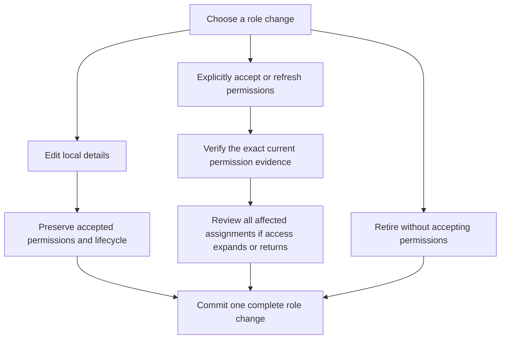
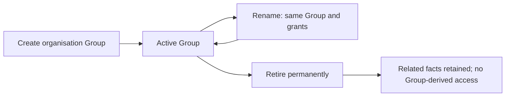

# Roles and Groups

[Access specification](../04-access-and-permissions.md) · [IAM application](iam-application.md) · [Data contracts](data-contracts.md#permission-and-role-contracts) · [Build plan](../../build-plan/README.md)

## Product model

The access-management model is **Roles and Groups**. A role defines exact permissions; a group
collects organisation accounts and can receive role assignments. A group is not a business
department, work queue or application-specific team. Those business concepts remain ordinary
application records and can refer to a group when their definitions require it.

An account may belong to several groups in its own organisation. Group membership does not cross
organisation or global-identity boundaries. Membership is explicit; there are no nested groups and
no rule-driven membership.

## Assignment

| Fact | Effect |
| --- | --- |
| Role assignment to an account | Gives the role's currently accepted permissions while the assignment and all other access conditions are valid. |
| Role assignment to a group | Makes each currently valid member receive the role's currently accepted permissions while the assignment and membership are valid. It does not create permissions for the whole group beyond what current members hold. |
| Removal, expiry or revocation | Ends the assignment's contribution on the next request. |

An account's effective permissions are the union of its valid direct and group-derived assignments,
narrowed by field restrictions and record scopes. A role assignment never substitutes for the
central Access decision; every protected operation still checks its current permission, tenant,
organisation, application, record and field conditions.

Membership, role-assignment and delegation time bounds stay fixed for each grant identity. Restore is
possible only while the membership's original expiry is absent or still in the future. After natural
expiry, renewal closes the old membership and creates a new membership identity and window through
one authorised change. It does not extend the old window or make the gap look like continuous access.
Only one non-revoked membership may occupy an organisation/Group/account pair, including a scheduled
or naturally expired row; renewal closes that predecessor before creating its replacement.

The initial [membership operations in #33](https://github.com/Abzum-NZ/Abzum-Vortex/issues/33) are
add, remove, restore and renew. Add, restore and renew require an active Group and active account in
that same organisation; removal can still revoke a retained membership after its source becomes
inactive. Renewal accepts an expired, non-revoked predecessor and derives the same Group/account from
it. If the predecessor was already revoked, use a fresh authorised add instead. Every successful
operation changes Access once, including renewal's two membership rows. Competing changes use the
existing reviewed revision and organisation transaction lock. The
[protected invocation #40](https://github.com/Abzum-NZ/Abzum-Vortex/issues/40) checks caller
authority, and the [IAM application](iam-application.md) supplies the human journey.

## Editing a role versus accepting permissions

Changing a role's local name or description is not permission acceptance. An application-role edit
preserves its accepted permission entries, original acceptance evidence and current lifecycle,
including a pending-review or unavailable state. It cannot make pending additions live or restore a
withdrawn permission. A custom-role edit likewise preserves its selected entries unless the
administrator explicitly chooses to replace or refresh that selection. A custom role copied from a
template remains independent and retains its original template provenance. The copy may keep a
nonempty exact subset of that template's currently assignable permissions, but cannot add unrelated
permissions within the copy operation; those require explicit custom-role selection. Accepting a
supplied application role uses the complete currently assignable template projection.

Accepting the current application template is a separate operation. It uses the exact currently
registered application release and template, not an arbitrary historical release. Replacing or
refreshing custom-role permissions also uses exact current permission evidence. Both operations
apply the [complete affected-assignment review](data-contracts.md#permission-and-role-contracts)
whenever authority is broadened or restored.

Retirement preserves the role's accepted snapshot and permanently prevents further use or
restoration. It must not depend on reading a currently available source application or accepting new
permissions. A stale request, duplicate creation, repeated retirement or request that changes none
of the stored configuration or acceptance evidence is refused without advancing the role or Access
version. There is no separate successful-replay receipt.

These are the required behaviours of the private
[role-change composition #33](https://github.com/Abzum-NZ/Abzum-Vortex/issues/33). The
[protected operation #40](https://github.com/Abzum-NZ/Abzum-Vortex/issues/40) and
[IAM journey #267](https://github.com/Abzum-NZ/Abzum-Vortex/issues/267) add current caller authority
and the permanent-steward safeguard.

## Creating, renaming and retiring Groups

An organisation creates a Group with a permanent identity and key plus an editable display label.
Renaming does not change its memberships or assigned roles. Retirement is permanent: the Group stops
supplying access, but its related membership, assignment and delegation records remain available as
evidence under their normal read permissions. It cannot be restored by reusing its key or changing
its label. Removing retained grants remains possible after retirement.

Creation, rename and retirement each commit one complete revisioned change and one Access-version
increment. Rename and retirement require the revision the administrator reviewed; a competing change
requires refresh rather than silently overwriting it. A role assignment racing retirement either
commits first and then becomes ineffective through the retired Group, or is refused after retirement.
The private [#33 composition](https://github.com/Abzum-NZ/Abzum-Vortex/issues/33) does not itself
expose administration: [#34](https://github.com/Abzum-NZ/Abzum-Vortex/issues/34) evaluates current
access, [#40](https://github.com/Abzum-NZ/Abzum-Vortex/issues/40) invokes protected changes with
#33's stewardship safeguards, and [IAM](iam-application.md) presents the authorised journey.
Membership changes are separate operations.

## Permanent management access

The existing [permanent-steward invariant](../04-access-and-permissions.md#initial-organisation-stewardship)
remains explicit. At least one nominated active account retains the exact direct, non-expiring
minimum management role and delegation, plus the required IAM operating role after setup. Those
narrowly scoped recovery/management roles permit standing access. They grant no unrelated
business-data use.

This is not a bypass flag on arbitrary assignments. A change that would remove the final qualifying
steward's management application or otherwise leave the organisation unable to administer itself is
refused unless a qualifying replacement is established atomically. Never infer this exception from a
name, tenant status or first sign-in.

## Current Group contract

Group is the single collective-principal term in current contracts, Definition ownership, Access
reasons and user-facing text. Do not introduce a second principal model. Membership, assignment and
stewardship use the protected operations described above.

Permanent identity is independent of display terminology. Coordinate any stored development-data
change with its owning schema; do not silently reinterpret an identity or edit an already-applied
migration.
