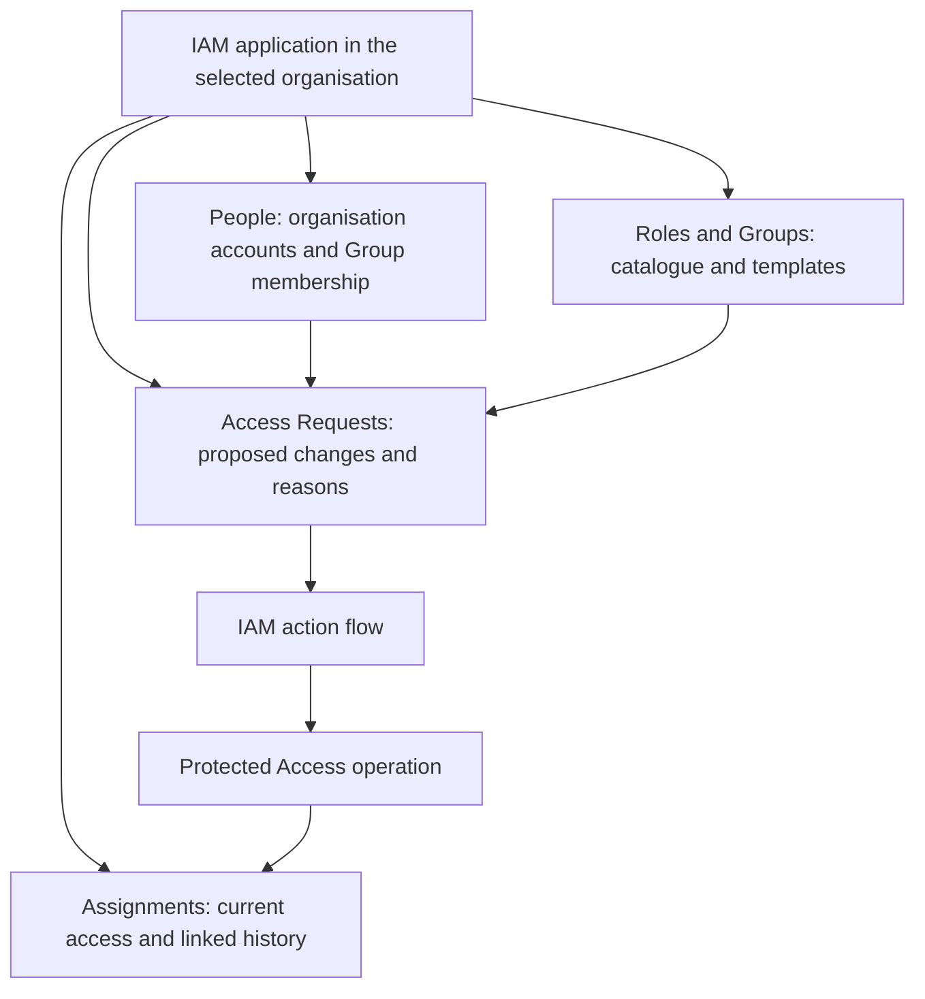
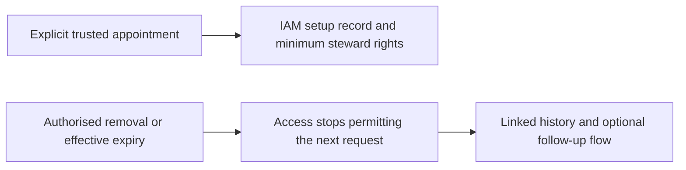

# IAM application: people, access requests and role grants

[Access rules](../04-access-and-permissions.md) · [Workflow rules](../09-workflows-and-pipelines.md) · [Application definitions #72](https://github.com/Abzum-NZ/Abzum-Vortex/issues/72)

## One application for managing access

Use **Roles and Groups** throughout IAM. IAM is the Vortex application through which people request, grant and remove access. Roles remain owned by an organisation; IAM is their management application, not a new global owner. Each application contributes its permissions and role templates to that organisation's catalogue. People receive assignments through their exact organisation account or a Group in that organisation, never through a global identity shared across organisations.

IAM uses ordinary versioned modules, records, relationships, pages, forms and actions. It is a [system application](../07-applications-pages-and-themes.md#system-applications) with platform-owned protected-operation bindings and update lineage, like the other administration applications. The core runtime does not recognise its display name, module names or business request states.

Tenant-governance journeys run through an IAM instance in that tenant where the person has an explicitly granted active organisation account and the necessary IAM operating role, as well as the separate tenant capability for the requested action. Tenant-administrator status alone does not open IAM or its request records. Request history stays in the IAM instance's organisation; tenant authority does not expose another organisation's application records.

## Records and ownership

| IAM module | Records or views | Authority |
| --- | --- | --- |
| People | Read-only system record type for organisation accounts and Group membership; requester and beneficiary links are ordinary links to it, and organisation-added fields reuse the system module's extension point | Existing [Identity](../02-people-organisations-and-sign-in.md) and [Access](../04-access-and-permissions.md) facts, not a copied user directory |
| Roles and Groups | Read-only system record types for available permissions, organisation roles, supplied templates, Groups and delegated management scope | Protected organisation catalogue through the Access operations |
| Access Requests | `access_request` and `access_request_item`: request, proposed change items, reason, target account or Group, role and permission version, application context, start and expiry | Ordinary application records describing intent; they confer no access |
| Assignments | Read-only system record type for current effective assignments, plus links to request and operation outcomes | Protected live Access facts read through the one [query path](../10-queries-reports-search.md#one-read-path); historical application records cannot recreate or override an effective assignment |

The system record types above are read through the one [query path](../10-queries-reports-search.md#one-read-path) under the viewer's current authority; IAM never caches or copies them, and only the protected operations below change their protected facts. They are never shared across organisations or written as ordinary records. A link to a person or a group is an ordinary link to the People or Group system record type, and an organisation may add its own extension fields through the system module's extension points. Global identity is used only to relate the person's accounts, not to transfer grants between them.

## Actions

The shipped application declares nine actions, each an ordinary flow bound to a protected Access operation or a record save:

| Action | Purpose |
| --- | --- |
| `update_own_profile` | Save the requester's own profile fields |
| `revise_role_metadata` | Change a role's local label and description |
| `rename_group` | Rename a Group |
| `make_steward` | Appoint a steward through the protected steward operation |
| `add_group_membership` | Add an account to a Group |
| `assign_role_assignment` | Assign a role to an account or Group |
| `create_custom_role` | Create an organisation-owned custom role |
| `grant_install_authority_person` | Grant organisation-catalogue delegation to a person |
| `grant_install_authority_group` | Grant organisation-catalogue delegation to a Group |

Each action flow calls the protected Access operation, which rechecks current actor authority, delegated scope, account and Group state, active catalogue evidence and the last-permanent-steward safeguard. A request record is ordinary intent: editing it, importing it, opening a copied address or calling a private helper cannot grant access. A grant is shown as effective only after the protected operation succeeds; a refused, cancelled, expired, changed or failed request gives no access.

The protected operation checks only current authority and its declared preconditions, never an approval field or an approver. Retries apply an accepted change once. Losing authority between request and application prevents the later grant.

## Initial application setup

App coordinates installation and Access owns the protected initial-operating-rights operation. Existing tenant provisioning nominates the first steward but does not already grant business-application roles.

The setup operation accepts the original provisioning receipt, nominated active organisation account, expected setup revision and one server-configured manifest containing the exact organisation, account, initial shipped application releases, operating roles and permission scope. A dedicated configured application-setup capability authorizes it; a tenant operator or application display name is not general role-grant authority. The Access composition applies only that frozen scope and records its rights outcome atomically.

The development setup command selects the fixed shipped manifest and calls the same protected composition. Incomplete setup remains resumable against the fixed manifest and does not advertise usable access before installation and operating rights are effective.

## Setup and removal

The first administrator's setup cannot depend on a responder who does not yet exist. IAM therefore includes a guided setup journey over the narrow trusted appointment and adoption operation. It explicitly names the steward and records the setup outcome. The core appointment supplies the [guarded platform steward minimum](platform-permission-catalogue.md#steward-minimum-and-guard) and delegation; the complete IAM setup also explicitly accepts the minimum operating role from the exact governed IAM release.

Once the system applications are installed, the permanent-steward safeguard covers the 13 platform permissions marked as the steward minimum, together with the operating access and application availability needed to use a management journey. Removing the last steward, or replacing a system application so that no steward can manage access, is refused until an authorised replacement is effective.

Authorised revocation runs immediately; it does not wait in a queue. Expiry, suspension and loss of Group membership are enforced on the next protected request. History and notification flows may follow removal but cannot delay it. The final permanent steward cannot be removed without an active replacement.

The initial membership journey uses one inactive state for removal or suspension, with an explicit authorised restore that advances its revision. Revoked role assignments and delegation instead need a new grant, and retired Groups cannot be restored. Restore retains the original membership start and expiry: a future-start membership remains scheduled, and an expired membership cannot be restored by stretching its old window. Renewal after expiry closes the old membership and creates a fresh membership with the newly authorised window.

Request and review data remain ordinary application functionality under the
[core contract boundary](core-contract-boundary.md); development acceptance follows
[code review](../20-quality-and-acceptance.md).
