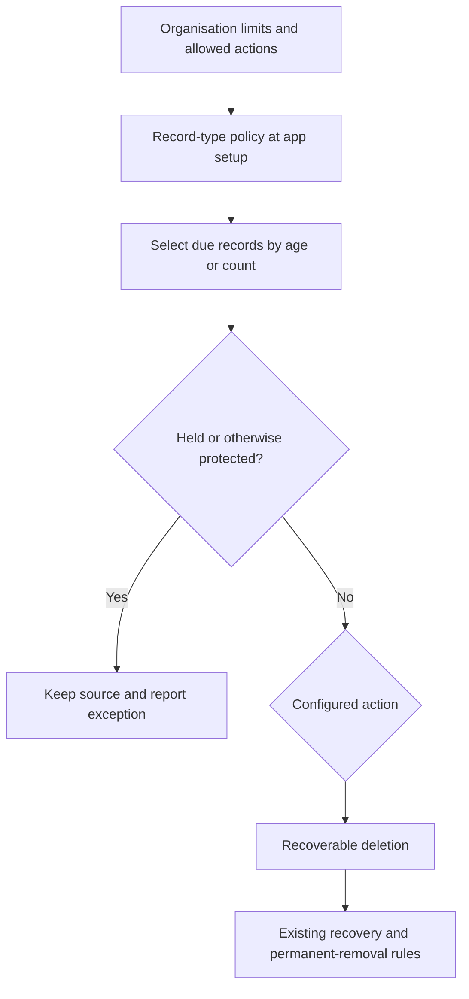

# Record ownership, offboarding and lifecycle policies

[Records](../06-records-and-lifecycle.md) · [People](../02-people-organisations-and-sign-in.md) · [Retention](../14-activity-privacy-and-retention.md)

These requirements implement the owner's 12 September 2026 decisions and state current behaviour.

## Initial ownership

For an account-owned record, the Access-resolved effective organisation account
performing the create is the initial owner (the creator in an ordinary request); a create form cannot nominate another account. For a Group-owned
record, the form must select an active Group in that organisation of which the
same effective account is currently a member. Missing, foreign, retired or non-member selections
are refused. Both cases also require the normal create and field permissions.
Recheck membership and account state in the create transaction. Ownership-disabled
types remain ownerless.

## Archive a person

Archiving a person means making their **organisation account inactive** through the existing protected account operation; it is not deletion of their global identity. Entry and account-derived authority stop under current Access rules. Their other organisation accounts are unaffected. The account remains available as historical attribution. Reactivation uses existing governed restoration and does not silently revive revoked grants.

Records owned by an archived account remain owned by it and stay subject to the ordinary lifecycle policy. Moving them to another owner is not a built operation; ownership changes go through the one record writer and require an explicit ownership action.

## Record-type lifecycle policy

Every installed record type has an explicit lifecycle policy selected by an
authorised administrator during application setup. It is not a PostgreSQL TTL
on a shared physical table. Policy scope is organisation + storage contract +
permanent application root ID for application-contained rows. Organisation-shared rows have
one organisation-owned policy referenced by all consuming applications. Ordinary
release/binding upgrades preserve policy identity, age and counts; installing
or editing another application cannot change it silently.

Organisation settings specify the maximum permitted retention days and maximum
retained-record count, and allowed end-of-life actions. Each
record-type policy may be stricter but not exceed those limits. Either limit may
be absent only when the organisation explicitly allows that absence; choosing
unlimited retention is an explicit setting, not a missing-policy fallback.

Age is elapsed UTC time since record creation, not since the last edit. Count
includes all retained records in that policy scope, including recoverable or held
records; permanently removed records do not count. At most N retained records are
within the count limit: excess candidates are selected oldest-created first, with
permanent record ID as the tie-breaker. If both age and count are configured,
either can make a record due. Count/age are lifecycle targets, not entitlement
quotas: blocked removal reports a visible over-limit condition rather than silently
deleting protected data or inventing a create denial.

The end-of-life action is an explicit recoverable deletion under the existing recovery policy. Archive destinations are not built. Permanent removal follows recovery periods, legal holds and privacy rules. There is no unrestricted SQL, URL or provider credential in a policy. Definition validation checks declared lifecycle shape and references; protected live policy save and application activation require a concrete policy within current organisation limits.

Definition validation checks declared lifecycle shape/references; protected live
policy save and application activation require a concrete
policy within current organisation limits and all capabilities that its selected
action needs.
Lowering organisation limits or changing a policy previews affected records and
requires the normal authorised confirmation, then applies the new policy revision
in bounded batches. It never starts an unbounded deletion inside settings save.

The maximum also covers recoverable source retention; the active period plus
recovery period must fit the organisation ceiling. Legal holds are an explicit exception, not a new unlimited policy.

## Scheduled time-based calculations

A value that depends on the current time, such as whether a named deadline has
passed, is a read-time computed field ([Decision 4](../../build-plan/architecture-decisions.md#decision-4--formulas-and-read-time-computed-fields)).
It is a [formula](frontend-rule-designer.md#formulas) that uses `now`, and it is
computed whenever the record is read. It is never stored, and no background
worker, due-time metadata or recalculation refreshes it. The first release's
read-time form is the deadline-passed calculation in
[05](../05-modules-fields-and-relationships.md#calculations-and-totals): it reads
the record's stored deadline and status and the explicitly listed terminal status
values, so an overdue record is correct at every read without a person editing it.
Neither a person, an agent nor a flow can submit a read-time value on save.

Detail views, list filters, sorting, grouping and query-time aggregation,
exports and page-model tools evaluate the same formula. A filterable or sortable read-time
field compiles to SQL inside the authorised query, so filtering, sorting and
paging run over every matching record rather than over an already-selected page.
One statement uses one statement timestamp in the organisation's time zone, which
also decides the current date for a date-only deadline, so the rows it returns
agree with each other. No read waits for, or is refused because of, pending
freshness. The value is disclosed only when the field and its inputs are readable
to the viewer, like any other calculated field. Components display the value the
engine returns and never compute it themselves. Queries that use a read-time
field bypass the data-result cache
([17](../17-runtime-storage-and-caching.md#cache-model)), because the value changes
without any data change.

Stored values never depend on a read-time field. A calculation that uses a
read-time field is itself read-time. A relationship total is stored, so
publication refuses a total whose aggregate source, aggregate-source filter or
dependency chain includes a read-time field. Calculations and totals that do not
depend on the current time remain stored and save-driven.
